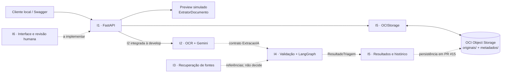
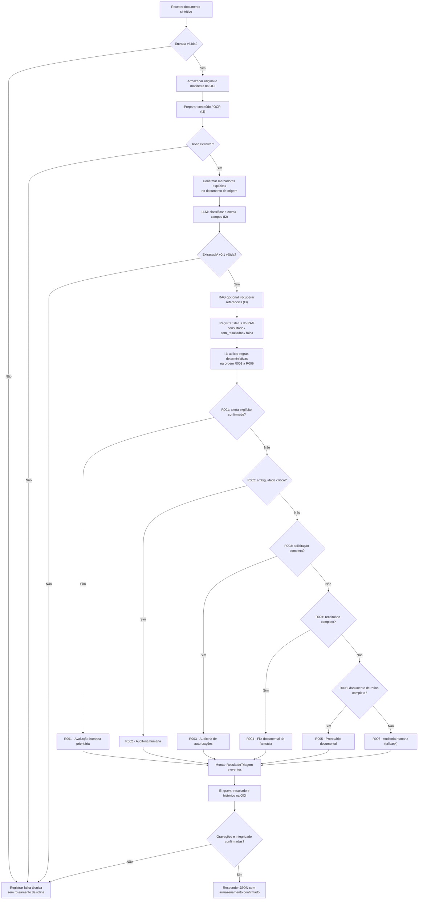

# MediFlow — Triagem documental assistida por IA

**Hackathon ONE | G10 — Equipo 17** · **Protótipo educacional** · **Contratos JSON/Pydantic v0.1**

O **MediFlow** é um projeto de apoio à **organização, classificação, extração e encaminhamento administrativo de documentos de saúde sintéticos**. A proposta combina uma API FastAPI, armazenamento na **Oracle Cloud Infrastructure (OCI)**, extração documental (OCR/IA), recuperação de referências (RAG) e um fluxo de decisão baseado em **regras determinísticas** orquestradas futuramente por LangGraph.

> **Aviso:** o MediFlow **não realiza diagnóstico, prescrição, dispensação de medicamentos ou decisões clínicas**. É um protótipo de hackathon, desenvolvido e validado apenas com **documentos fictícios/sintéticos**. Não está autorizado para dados reais de pacientes nem para exposição pública sem controles adicionais.

## Sumário

- [1. Estado atual do projeto](#1-estado-atual-do-projeto)
- [2. Arquitetura e responsabilidades](#2-arquitetura-e-responsabilidades)
- [3. Fluxo de decisão do agente (arquitetura-alvo)](#3-fluxo-de-decisão-do-agente-arquitetura-alvo)
- [4. Contratos e regras](#4-contratos-e-regras)
- [5. Estrutura do repositório](#5-estrutura-do-repositório)
- [6. Instalação e execução local](#6-instalação-e-execução-local)
- [7. OCI Object Storage: configuração e teste](#7-oci-object-storage-configuração-e-teste)
- [8. Endpoints disponíveis na develop](#8-endpoints-disponíveis-na-develop)
- [9. Módulos em integração e próximos passos](#9-módulos-em-integração-e-próximos-passos)
- [10. Testes, segurança e colaboração](#10-testes-segurança-e-colaboração)

## 1. Estado atual do projeto

**Referência da auditoria:** 02/11/2026; branch de integração `develop` no commit `9031952`. A branch `main` permanece como referência estável anterior. **As funcionalidades abaixo são descritas conforme a branch indicada, não como um MVP integrado já concluído.**

| Módulo / recurso | Na `develop` | Em desenvolvimento ou revisão |
| --- | --- | --- |
| **I1 — FastAPI** | `GET /health`; recebimento de PDF/PNG/JPEG; consulta de manifestos; listagem por documento com paginação; preview de extração **simulado** | Integração com RAG, regras e fluxo completo de processamento |
| **I2 — Extração** | Modelos e validação do contrato `ExtracaoIA`; interface substituível `ExtratorDocumento` | PyMuPDF + Tesseract (PDF e imagens) + Gemini + rota de extração real integrada à `develop`
| **I3 — RAG** | Contratos `FonteRAG` e `RecuperacaoRAG` | Recuperador local por palavras-chave e 14 fichas versionadas: [PR #16 (Draft)](https://github.com/No-Country-simulation/G10-BRASIL-EQUIPO17/pull/16) |
| **I4 — Regras/agente** | Catálogo R001–R006, validações V001–V004 e geração **demonstrativa** de contratos por funções puras | Motor integrado ao pipeline e orquestração LangGraph **não presentes na `develop`** |
| **I5 — OCI** | Adaptador `OCIStorage`; gravação e leitura de originais e manifestos; verificação SHA-256; listagem por prefixo | Persistência de resultado/histórico: [PR #15](https://github.com/No-Country-simulation/G10-BRASIL-EQUIPO17/pull/15); monitoramento, IAM e deploy operacional fora do código |
| **I6 — Interface/QA** | Testes automatizados, cenários sintéticos e estrutura inicial de UI | Interface e painel de revisão humana pendentes |

**PRs relacionados:** os PRs [#11](https://github.com/No-Country-simulation/G10-BRASIL-EQUIPO17/pull/11) e [#13](https://github.com/No-Country-simulation/G10-BRASIL-EQUIPO17/pull/13) foram encerrados após a consolidação das funcionalidades de OCR e extração no [PR #14](https://github.com/No-Country-simulation/G10-BRASIL-EQUIPO17/pull/14), integrado à `develop`. O [PR #12](https://github.com/No-Country-simulation/G10-BRASIL-EQUIPO17/pull/12), de `develop` para `main`, é uma proposta de promoção e deve ser tratado conforme seu estado atual.

### O que funciona hoje

- Receber um documento sintético em `multipart/form-data`, validando formato, MIME, assinatura, tamanho e limites de páginas.
- Armazenar **original** e **manifesto** no Object Storage privado; cada upload recebe `arquivo_id` independente, evitando sobrescrita entre reenvios.
- Consultar um manifesto pelo par `documento_id`/`arquivo_id` e listar uploads associados ao mesmo `documento_id`.
- Recuperar o arquivo armazenado, conferir sua integridade e acionar um **extrator simulado** que retorna um contrato neutro, sem análise por IA.
- Executar testes locais e CI em Python 3.12 e 3.13, sem credenciais Oracle ou Gemini.

**Ainda não funciona de ponta a ponta na `develop`:** OCR real → Gemini → RAG → regras/fluxo LangGraph → resultado final persistido → interface. `POST /v1/triagens/texto` continua respondendo **501** para entradas válidas, intencionalmente.

## 2. Arquitetura e responsabilidades

O repositório é um **monorepo Python**. Cada módulo publica uma interface clara; I1 coordena as requisições e a integração, mas não deve embutir a implementação interna de I2/I3/I4/I5.



**Linhas contínuas:** caminho existente na `develop`. **Linhas pontilhadas:** interfaces ou integrações ainda pendentes, mesmo quando existe código em PR.

| Área | Responsabilidade técnica | Módulos principais |
| --- | --- | --- |
| **I1 — Arquitetura e API** | FastAPI, contratos de borda, endpoints, integração e fluxo das requisições | `src/mediflow/api/` |
| **I2 — Extração** | Preparação textual/OCR, classificação e extração estruturada por modelo | `src/mediflow/extraction/`, `ingestion/` |
| **I3 — RAG** | Curadoria, recuperação e citação de referências | `src/mediflow/rag/` |
| **I4 — Regras/agente** | Validação documental, precedência das regras e orquestração LangGraph | `src/mediflow/rules/`, `agents/`, `rules/` |
| **I5 — Nuvem/segurança** | Object Storage, persistência, IAM, identidade de serviços, observabilidade e preparação do deploy | `src/mediflow/storage/` e recursos OCI |
| **I6 — Interface/qualidade** | Interface de demonstração, revisão humana e testes ponta a ponta | `src/mediflow/ui/`, `tests/` |

A infraestrutura de desenvolvimento OCI já utiliza compartment e bucket privados. Usuários IAM têm identidades individuais e acesso por menor privilégio. **O nome da tenancy pessoal, endereços de e-mail, OCIDs, chaves e dados financeiros não são necessários neste README e não devem ser publicados.**

## 3. Fluxo de decisão do agente (arquitetura-alvo)

**Este é o fluxo planejado para o MVP, não uma afirmação de que o grafo LangGraph já executa na `develop`.** A execução determinística, as verificações de evidência e a persistência final dependerão das integrações de I1/I2/I3/I4/I5.



**Invariantes do desenho:**

- **R001 tem precedência sobre R002**, mas uma ambiguidade concomitante deve continuar registrada. A presença de alerta **não pode ser comprovada somente pelo que a LLM afirmou**; exige verificação independente no conteúdo recebido.
- O **RAG só recupera e cita** fichas de referência. Não executa regras, não identifica urgência por conta própria e não rebaixa prioridades. `sem_resultados` e `falha` são situações distintas.
- **R004** encaminha o receituário à fila **documental** da farmácia; não dispensa medicamentos.
- **R006** é o fallback para documentos sem condição de roteamento; **falhas técnicas** devem ser tratadas separadamente, sem fingir conclusão da triagem.
- O status de armazenamento **`confirmado` só pode ser informado depois da confirmação do original, resultado e histórico** exigidos pelo contrato, com as verificações de integridade aplicáveis.

[Fontes do grafo v0.1 em Mermaid, Graphviz, SVG e PNG](diagramas/grafo_mediflow_v0.1.md) · [Regras oficiais R001–R006](rules/roteamento.yaml) · [Validações V001–V004](rules/validacao.yaml).

## 4. Contratos e regras

**Fonte canônica:** [`src/mediflow_contracts/models.py`](src/mediflow_contracts/models.py). Os arquivos de [`schemas/`](schemas/) são **gerados** a partir dos modelos; não os edite manualmente.

| Contrato | Finalidade |
| --- | --- |
| `EntradaTexto` / `EntradaProcessada` | Identificação, origem e tipo da entrada |
| `ExtracaoIA` | Categoria, campos extraídos, evidências e sinais documentais |
| `FonteRAG` / `RecuperacaoRAG` | Fontes citadas e status da recuperação |
| `ResultadoTriagem` | Classificação, validação, decisão, RAG, armazenamento e eventos |
| `ArmazenamentoOCI` | Estado e chaves de original, resultado e histórico |

| Regra | Condição de referência | Destino de simulação administrativa |
| --- | --- | --- |
| **R001** | Marcador explícito de possível urgência **confirmado** | `fila_prioritaria_avaliacao_humana` |
| **R002** | Ambiguidade crítica | `auditoria_humana` |
| **R003** | Solicitação de exame documentalmente completa | `auditoria_autorizacoes` |
| **R004** | Receituário documentalmente completo | `fila_farmacia_documental` |
| **R005** | Documento de rotina documentalmente completo | `prontuario_documental` |
| **R006** | Nenhuma regra anterior aplicável | `auditoria_humana` |

O módulo [`src/mediflow_contracts/routing.py`](src/mediflow_contracts/routing.py) **gera exemplos de contrato e exercita regras puras**; não constitui um motor executável de triagem conectado à API. Os destinos de [`config/destinos.json`](config/destinos.json) são **filas simuladas**, sem integração clínica.

Para atualizar schemas após uma alteração aprovada dos modelos:

```bash
python scripts/exportar_schemas.py
```

## 5. Estrutura do repositório

```text
G10-BRASIL-EQUIPO17/
├── .github/workflows/ci.yml       # CI Python 3.12 e 3.13
├── amostras/                       # PDFs e imagem sintéticos
├── baseline_dia1/                  # Backlog e cenários de referência
├── config/                         # Destinos simulados
├── diagramas/                       # Mermaid, DOT, SVG e PNG
├── docs/                           # Decisões, arquitetura e integração
├── exemplos/                       # Entradas e saídas JSON sintéticas
├── rules/                          # roteamento.yaml e validacao.yaml
├── schemas/                        # JSON Schemas gerados
├── scripts/                        # Utilitários e validações
├── src/
│   ├── mediflow/
│   │   ├── api/                   # FastAPI e rotas locais
│   │   ├── extraction/            # Port e validação do contrato
│   │   ├── rag/                   # Módulo I3 (incremento em PR #16)
│   │   ├── agents/                # Orquestração futura
│   │   ├── rules/                 # Integração futura do motor
│   │   ├── storage/               # OCIStorage
│   │   └── ui/                    # Interface futura
│   └── mediflow_contracts/        # Modelos canônicos v0.1
├── tests/                           # Testes automatizados
├── CONTRIBUTING.md                  # Fluxo de contribuição
└── pyproject.toml                    # Dependências e configuração Python
```

> Os nomes históricos `dia01`, `dia02`, `dia03` foram preservados em documentos/testes antigos. Eles não representam o estágio atual de desenvolvimento.

## 6. Instalação e execução local

### 6.1. Pré-requisitos

- Git instalado;
- **Python 3.12 ou 3.13** (`py -3.12` é o caminho documentado no Windows);
- acesso ao repositório;
- **OCI não é necessária** para executar a suíte padrão de testes ou iniciar apenas o endpoint `/health`.

### 6.2. Windows — PowerShell (passo a passo)

1. Abra o **PowerShell**.
2. Clone o repositório e entre na pasta:

   ```powershell
   git clone https://github.com/No-Country-simulation/G10-BRASIL-EQUIPO17.git
   cd G10-BRASIL-EQUIPO17
   git switch develop
   ```

3. Crie o ambiente virtual e instale as dependências de desenvolvimento:

   ```powershell
   py -3.12 -m venv .venv
   .\.venv\Scripts\python.exe -m pip install --upgrade pip
   .\.venv\Scripts\python.exe -m pip install -e ".[dev]"
   ```

4. Execute a validação local:

   ```powershell
   .\.venv\Scripts\python.exe -m pytest -q
   .\.venv\Scripts\python.exe -m compileall -q src scripts tests
   ```

   **Esperado:** testes aprovados e saída silenciosa do `compileall` em caso de sucesso. A quantidade de testes pode mudar entre commits.

5. Inicie o servidor **somente em loopback**:

   ```powershell
   .\.venv\Scripts\python.exe -m uvicorn mediflow.api.app:app --reload --host 127.0.0.1 --port 8000
   ```

6. No navegador, abra `http://127.0.0.1:8000/docs` (Swagger) e `http://127.0.0.1:8000/health`. Para encerrar, pressione **Ctrl+C** no terminal.

### 6.3. Linux / macOS (passo a passo)

1. Abra o terminal e clone o projeto:

   ```bash
   git clone https://github.com/No-Country-simulation/G10-BRASIL-EQUIPO17.git
   cd G10-BRASIL-EQUIPO17
   git switch develop
   ```

2. Crie o ambiente virtual e instale as dependências:

   ```bash
   python3.12 -m venv .venv
   .venv/bin/python -m pip install --upgrade pip
   .venv/bin/python -m pip install -e '.[dev]'
   ```

3. Execute os testes e a verificação de sintaxe:

   ```bash
   .venv/bin/python -m pytest -q
   .venv/bin/python -m compileall -q src scripts tests
   ```

4. Inicie a API local:

   ```bash
   .venv/bin/python -m uvicorn mediflow.api.app:app --reload --host 127.0.0.1 --port 8000
   ```

5. Abra `http://127.0.0.1:8000/docs`. Para interromper o servidor, pressione **Ctrl+C**.

### 6.4. Resultado esperado sem OCI

`GET /health` retorna HTTP **200** com `status: "ok"`; isso **comprova somente que a API responde**, não a saúde da OCI, OCR, Gemini ou RAG.

Os endpoints de arquivo ficam **bloqueados por padrão** (HTTP **403**) até a habilitação explícita para desenvolvimento local.

## 7. OCI Object Storage: configuração e teste

### 7.1. Requisitos de acesso

O armazenamento da aplicação está em um **bucket privado de desenvolvimento**. O responsável pela tenancy deve fornecer a cada colaborador uma **identidade IAM individual**, grupo/política de menor privilégio e acesso ao **bucket existente**. Não crie uma nova tenancy ou um bucket para testar o código.

1. Solicite a associação do seu usuário OCI a um grupo que possua as permissões adequadas para a operação desejada (leitura para consulta, escrita somente quando necessária).
2. No console OCI, abra seu perfil de usuário e configure uma **API key própria**, guardando a chave privada apenas na sua máquina.
3. Prepare o arquivo OCI `~/.oci/config` com perfil, `user`, `fingerprint`, `tenancy`, `region` e `key_file` correspondentes **ao seu próprio usuário**. Nunca envie esse arquivo ao Git.
4. Confirme que seu usuário consegue abrir o bucket na região correta. O SDK utiliza o mesmo namespace e bucket, mas suas credenciais são independentes das credenciais de outras pessoas.

O SDK OCI lê o arquivo de configuração padrão ou o caminho indicado por `OCI_CONFIG_FILE`. O namespace é obtido automaticamente se `OCI_NAMESPACE` não estiver definido.

### 7.2. Habilitar OCI no Windows (somente ambiente local autorizado)

1. Abra um **novo PowerShell** na raiz do projeto, com `.venv` já criado.
2. Instale o extra `cloud`:

   ```powershell
   .\.venv\Scripts\python.exe -m pip install -e ".[dev,cloud]"
   ```

3. Configure as variáveis **na sessão atual** (ajuste o perfil se usar outro nome no seu `~/.oci/config`):

   ```powershell
   $env:MEDIFLOW_ENV = "development"
   $env:MEDIFLOW_ENABLE_LOCAL_UPLOADS = "true"
   $env:OCI_CONFIG_FILE = "$HOME\.oci\config"
   $env:OCI_CONFIG_PROFILE = "MEDIFLOW"
   $env:OCI_BUCKET = "mediflow-docs-dev"
   # OCI_NAMESPACE é opcional: o SDK pode descobri-lo automaticamente.
   ```

4. Inicie a API **apenas** em `127.0.0.1`:

   ```powershell
   .\.venv\Scripts\python.exe -m uvicorn mediflow.api.app:app --reload --host 127.0.0.1 --port 8000
   ```

5. Abra `http://127.0.0.1:8000/docs`, expanda **POST `/v1/triagens/arquivos`**, clique em **Try it out** e preencha:
   - `documento_id`: `DOC-001` (ou outro ID sintético autorizado);
   - `canal_origem`: `teste_sintetico`;
   - `arquivo`: uma amostra de `amostras/pdf/` ou `amostras/imagens/`.
6. Clique em **Execute**. Com credenciais de escrita corretas, a resposta esperada é HTTP **201**, `status: "recebido"` e `triagem_executada: false`.
7. Copie o `arquivo_id` do recibo, execute o **GET individual** e depois o **GET de listagem** pelo Swagger.
8. Para testar a passagem de bytes à interface I2 **sem usar IA**, execute o **GET `/extracao-preview`**, com o mesmo par `documento_id`/`arquivo_id`. O retorno informa `modo: "simulacao_tecnica"` e `triagem_executada: false`.

**Atenção:** o upload exige autorização de **criação de objetos**, não apenas leitura. Um integrante com acesso somente de leitura poderá consultar o bucket, mas **não** concluir o POST de upload. Não use a credencial de administrador de outra pessoa para contornar a política.

### 7.3. Linux / macOS — variáveis equivalentes

No terminal em que iniciará a API (com o extra `cloud` instalado):

```bash
export MEDIFLOW_ENV=development
export MEDIFLOW_ENABLE_LOCAL_UPLOADS=true
export OCI_CONFIG_FILE="$HOME/.oci/config"
export OCI_CONFIG_PROFILE=MEDIFLOW
export OCI_BUCKET=mediflow-docs-dev
.venv/bin/python -m uvicorn mediflow.api.app:app --reload --host 127.0.0.1 --port 8000
```

### 7.4. Organização dos objetos na OCI

```text
bucket de desenvolvimento/
├── originais/<documento_id>/<arquivo_id>.<ext>
└── metadados/<documento_id>/<arquivo_id>.json
```

O manifesto contém nome, formato, hash SHA-256, tamanho e associação com o original. Cada novo upload gera outro `arquivo_id`; falhas parciais podem deixar objetos órfãos que exigem conciliação. **Não confunda o recibo de original com confirmação da triagem final.** As chaves de resultado e histórico fazem parte do incremento [PR #15](https://github.com/No-Country-simulation/G10-BRASIL-EQUIPO17/pull/15), ainda não integrado à `develop` nesta referência.

O script `scripts/validar_oci_integracao.py` **efetua gravações reais** em `testes/validacao/` e deve ser executado somente por quem recebeu permissão explícita para esse prefixo; não faz parte dos testes padrão.

## 8. Endpoints disponíveis na develop

| Método | Rota | Comportamento atual |
| --- | --- | --- |
| `GET` | `/health` | HTTP 200: saúde **somente** da API |
| `POST` | `/v1/triagens/texto` | Valida o corpo e responde **501** intencionalmente para entrada válida |
| `POST` | `/v1/triagens/arquivos` | Recebe PDF/PNG/JPEG sintético, grava original/manifesto e devolve HTTP **201** |
| `GET` | `/v1/triagens/arquivos/{documento_id}/{arquivo_id}` | Recupera e valida o manifesto do upload |
| `GET` | `/v1/triagens/arquivos/{documento_id}` | Lista os uploads do documento; `limite` (1–50) e `cursor` opcionais |
| `GET` | `/v1/triagens/arquivos/{documento_id}/{arquivo_id}/extracao-preview` | Verifica bytes/SHA-256 e retorna **simulação técnica**, sem IA |

As rotas relacionadas a arquivos são **exclusivamente locais** e exigem simultaneamente `MEDIFLOW_ENV=development`, `MEDIFLOW_ENABLE_LOCAL_UPLOADS=true` e acesso por cliente local. Não as exponha por `0.0.0.0`, proxy, túnel ou domínio público sem autenticação e autorização reais.

**Restrições de ingestão:** PDF, PNG e JPEG; até **10 MiB por arquivo**; PDF até **10 páginas**. O sistema valida MIME, extensão e assinatura; isso **não substitui antivírus** ou controles contra conteúdo malicioso.

### Rota de extração real

A rota `POST /v1/triagens/arquivos/{documento_id}/{arquivo_id}/extracao` está integrada à `develop`. Ela recupera o documento original na OCI, verifica sua integridade por tamanho e SHA-256, extrai texto de PDFs e imagens com PyMuPDF e Tesseract e utiliza o Gemini para gerar dados estruturados validados pelo contrato `ExtracaoIA`. A validação de evidências documentais verifica se os trechos informados estão presentes no conteúdo extraído. Os testes automatizados utilizam mocks e não substituem uma chamada real controlada à API do Gemini.

## 9. Módulos em integração e próximos passos

1. **I2 / Extração:** realizar uma chamada real controlada ao Gemini com documento sintético, avaliar latência, comportamento diante de indisponibilidade da API e qualidade das evidências extraídas.
2. **I3 / PR #16:** concluir empacotamento das 14 fichas no wheel, robustecer a verificação de sincronização com os YAMLs, preservar rastreabilidade e integrar o recuperador somente após revisão.
3. **I5 / PR #15:** revisar e integrar o serviço isolado de resultado/histórico; testar na OCI real com objetos sintéticos antes de declarar a persistência final homologada.
4. **I4:** implementar o processamento determinístico ligado ao fluxo e a orquestração LangGraph, com testes específicos dos cenários e da precedência R001–R006.
5. **I1:** integrar as portas de extração, RAG e regras, mantendo rastreabilidade, erros seguros e associação `documento_id`/`arquivo_id`.
6. **I6:** validar cenários de ponta a ponta, interface de demonstração e revisão humana.
7. **Infraestrutura:** autenticação/autorização da aplicação, observabilidade e deploy OCI somente após avaliação de limites do plano gratuito. Alertas e políticas de IAM operacionais são administrados na console e não estão automaticamente provisionados pelo repositório.

### Cenários sintéticos de aceitação

| Cenário | Objetivo de validação (planejado) |
| --- | --- |
| **DOC-001** | Documento de rotina completo → fluxo documental de rotina, conforme o gabarito e as evidências |
| **DOC-002** | Marcador explícito confirmado → **R001** e avaliação humana prioritária, sem depender de inferência da LLM |
| **DOC-005** | Documento ilegível/ambíguo → **R002** e revisão humana, sem inventar campos ausentes |

Os resultados esperados estão em [`baseline_dia1/`](baseline_dia1/), [`amostras/`](amostras/) e [`exemplos/`](exemplos/). **Não afirmar que esses cenários já passaram no pipeline completo** até existir teste ponta a ponta executado e registrado.

## 10. Testes, segurança e colaboração

### Testes e CI

- CI: [`.github/workflows/ci.yml`](.github/workflows/ci.yml), executada em PRs para `develop`/`main` e em pushes nas branches permanentes.
- Ambiente de teste padrão: dependências `.[dev]`, sem credenciais OCI ou Gemini, usando fakes/mocks.
- Comandos Windows:

  ```powershell
  .\.venv\Scripts\python.exe -m pytest -q
  .\.venv\Scripts\python.exe -m compileall -q src scripts tests
  ```

- Comandos Linux/macOS:

  ```bash
  .venv/bin/python -m pytest -q
  .venv/bin/python -m compileall -q src scripts tests
  ```

### Segurança e limites

- **Somente documentos sintéticos.** Nada de dados pessoais/saúde reais, diagnósticos ou uso clínico.
- Não versionar `.env`, API keys, OCI `config`, arquivos `*.pem`, tokens, OCIDs sensíveis ou segredos. Nunca registrar conteúdo integral de documentos ou senhas nos logs.
- O bloqueio por loopback/variáveis de ambiente é um controle **temporário de desenvolvimento**, não autenticação da aplicação.
- Cada integrante usa usuário IAM/chave própria e menor privilégio. O ambiente OCI de desenvolvimento pode compartilhar uma tenancy com outros projetos: não solicitar nem conceder privilégios globais desnecessários.
- Todo retorno derivado de IA precisa ser verificável e claramente identificado; nenhum falso `armazenamento_oci.status="confirmado"`.
- A execução de scripts OCI e de APIs LLM pode gerar requisições/custos; consulte o responsável pelo ambiente antes de rodar integrações reais.

### Fluxo de colaboração

1. Consulte o [backlog](baseline_dia1/backlog.csv), o [mapa de colaboração](docs/06_mapa_colaboracao.md) e o [CONTRIBUTING.md](CONTRIBUTING.md).
2. Atualize `develop` (`git switch develop` e `git pull --ff-only origin develop`) e crie uma branch **por funcionalidade** (`feat/`, `fix/`, `docs/`, `test/`, `refactor/` ou `chore/`).
3. Adicione testes e documentação proporcionais à alteração. Não edite modelos, esquemas ou regras de outra área sem alinhamento.
4. Execute `pytest` e `compileall`; confira `git diff --check` e verifique que não existem segredos/dados reais no diff.
5. Publique a branch e abra **PR com base `develop`**. Descreva finalidade, riscos, testes, critérios de aceite e peça revisão de pelo menos outra área.
6. Faça merge somente após revisão e CI aprovadas. Promova `develop` → `main` apenas quando a demonstração estável estiver validada.

### Referências do projeto

- [Guia de colaboração](CONTRIBUTING.md)
- [Contratos de API](docs/dia02/01_contrato_api.md)
- [Arquitetura do monorepo (registro histórico)](docs/01_arquitetura_monorepo.md)
- [Ingestão e segurança local](docs/07_ingestao_arquivos_oci.md)
- [Manifestos e listagem no OCI](docs/08_associacao_metadados_oci.md)
- [Interface de extração simulada](docs/09_interface_api_extracao.md)
- [Grafo de decisão versionado](diagramas/grafo_mediflow_v0.1.md)

## Integração I2 — OCR e Gemini

A integração I2 é responsável pela preparação do conteúdo documental, extração de texto por OCR e geração de dados estruturados com IA.

### Recursos

- **OCR:** extração de texto de PDFs e imagens com Tesseract.
- **Gemini:** utilização da API do Google Gemini para gerar dados estruturados conforme o contrato `ExtracaoIA`.
- **Validação:** validação dos dados retornados pela IA utilizando os contratos Pydantic.
- **Preview:** rota de demonstração com respostas simuladas, sem chamada ao Gemini real.

### Configuração do Gemini

A integração I2 utiliza a API do Google Gemini para gerar dados estruturados conforme o contrato `ExtracaoIA`. A chamada real exige uma chave válida e deve ser realizada somente em homologação controlada, utilizando documentos sintéticos.

#### Configuração do modelo

A variável `GEMINI_MODEL` permite selecionar o modelo utilizado na extração.
Caso não seja configurada ou esteja vazia, será utilizado `gemini-3.8-flash`.

**Linux/macOS:**
```bash
export GEMINI_MODEL="gemini-3.1-flash-lite"
$env:GEMINI_MODEL="gemini-3.1-flash-lite"
```

#### Instalação das dependências de IA

Na raiz do repositório, com o ambiente virtual ativado:

**Linux/macOS:**
```bash
.venv/bin/python -m pip install -e '.[dev,ai]'
```

**Windows (PowerShell):**
```powershell
.\.venv\Scripts\python.exe -m pip install -e ".[dev,ai]"
```

#### Configuração da chave

Configure a variável `GEMINI_API_KEY` sem publicar ou compartilhar sua chave.

**Linux/macOS:**
```bash
export GEMINI_API_KEY="SUA_CHAVE"
```

**Windows (PowerShell):**
```powershell
$env:GEMINI_API_KEY="SUA_CHAVE"
```

O arquivo `.env.example` contém a variável `GEMINI_API_KEY=` como referência, sem credenciais reais. A aplicação utiliza a variável de ambiente; não coloque sua chave diretamente no código ou em arquivos versionados.

#### Instalação do Tesseract OCR

O pacote Python `pytesseract` não instala o executável Tesseract. Ele precisa estar instalado no sistema operacional, com o idioma português disponível.

**Ubuntu/Debian:**
```bash
sudo apt update
sudo apt install tesseract-ocr tesseract-ocr-por
```

**Windows:**

1. Instale o Tesseract OCR por meio de um instalador confiável para Windows.
2. Durante a instalação, inclua o idioma português (`por`).
3. Adicione a pasta de instalação do Tesseract à variável `PATH` do sistema, se necessário.
4. Abra um novo PowerShell e verifique:
```powershell
tesseract --version
tesseract --list-langs
```

A lista de idiomas deve apresentar `por`. No Linux, a mesma verificação pode ser feita com os mesmos comandos.

#### Homologação real controlada

A homologação real do Gemini deve utilizar exclusivamente documentos sintéticos, sem dados pessoais ou informações clínicas reais.

O teste deve verificar:
- classificação do documento;
- conformidade da resposta com `ExtracaoIA` versão `0.1`;
- campos extraídos e evidências correspondentes ao conteúdo original;
- latência da chamada;
- tratamento de indisponibilidade, timeout e erros da API.

Os testes automatizados com mocks validam o comportamento do adaptador sem consumir a API. Eles não substituem a homologação real. Uma chamada bem-sucedida isolada também não comprova disponibilidade contínua do serviço.

A extração é um recurso de apoio à organização documental. Não realiza diagnóstico, prescrição ou decisão clínica, e seus resultados exigem validação humana.
---

**Estado:** protótipo educacional em integração. O objetivo é demonstrar rastreabilidade de documentos sintéticos, respeito aos contratos, validação determinística e revisão humana, **não** substituir avaliação profissional ou operar um sistema clínico real.


**Importante:** esses comandos configuram a variável apenas na sessão atual do terminal.
Faça essa inserção e me avise. Depois vamos ao terceiro ajuste: verificar se o modelo selecionado realmente chega ao `generate_content()`.
