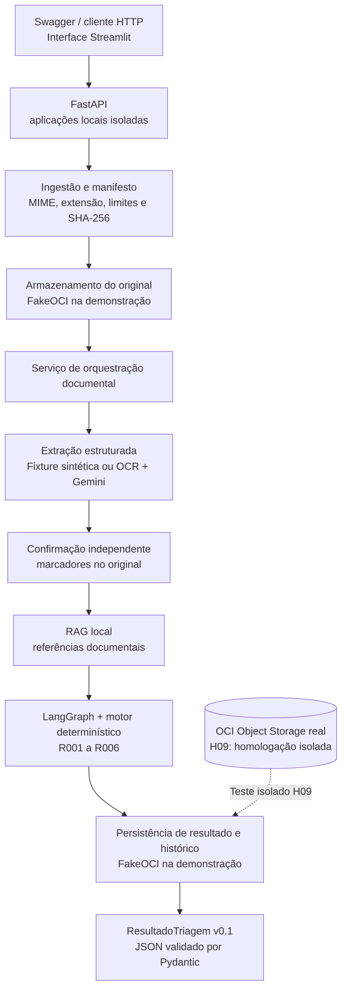
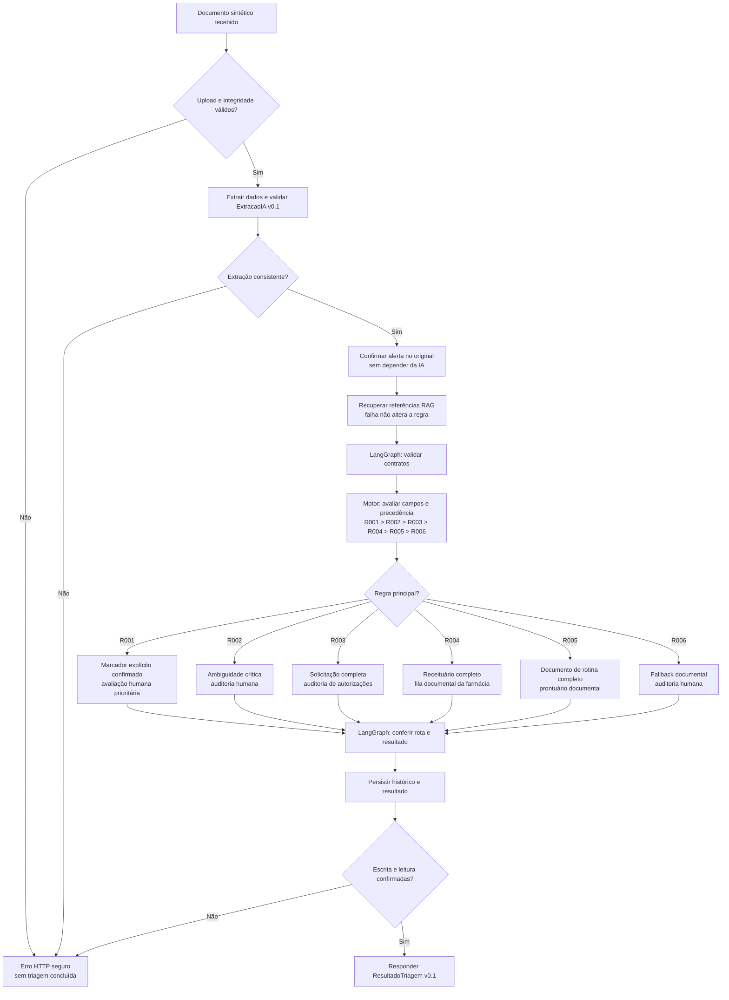

# MediFlow

### Agente de triagem e roteamento documental assistido por IA

**Hackathon ONE — Grupo 10 · Equipe 17**

**Stack:** Python · FastAPI · Pydantic · PyMuPDF · Tesseract OCR · Google Gemini · RAG local · LangGraph · Oracle Cloud Infrastructure (OCI)

O **MediFlow** é um protótipo educacional para receber documentos de saúde **sintéticos**, extrair informações estruturadas, identificar inconsistências documentais e encaminhar cada arquivo a uma **fila administrativa simulada**. O projeto combina OCR e extração por IA com regras determinísticas, um grafo condicional, recuperação de referências e persistência auditável.

> [!IMPORTANT]
> **Não é um sistema clínico.** O MediFlow não diagnostica, prescreve, define condutas, autoriza procedimentos nem dispensa medicamentos. Os dados e documentos de demonstração são fictícios. **Não utilize dados reais de pacientes, não exponha os serviços à internet e não interprete alertas documentais como avaliação médica.**

**Estado verificado na branch `develop`:** a demonstração HTTP local processa os três cenários oficiais, com **extração por fixtures** e **FakeOCI em memória**, enquanto RAG, confirmação independente, regras e LangGraph são executados localmente. A extração por Gemini e a persistência Oracle real possuem implementações e validações específicas, **mas o fluxo HTTP completo com ambos os serviços reais ainda não foi homologado**.

## Índice

- [Visão geral e estado do MVP](#visão-geral-e-estado-do-mvp)
- [Arquitetura](#arquitetura)
- [Fluxo de decisão do agente](#fluxo-de-decisão-do-agente)
- [Cenários de demonstração](#cenários-de-demonstração)
- [Tecnologias e organização do projeto](#tecnologias-e-organização-do-projeto)
- [Instalação](#instalação)
- [Executar a demonstração local](#executar-a-demonstração-local)
- [Modos de API e endpoints](#modos-de-api-e-endpoints)
- [Contratos, regras e persistência](#contratos-regras-e-persistência)
- [Testes e evidências](#testes-e-evidências)
- [Segurança e limitações](#segurança-e-limitações)
- [Próximas etapas](#próximas-etapas)
- [Documentação e colaboração](#documentação-e-colaboração)

## Visão geral e estado do MVP

| Capacidade | Estado comprovado na `develop` |
|---|---|
| Recepção de PDF, PNG e JPEG, com manifesto e SHA-256 | **Implementada**; testes HTTP e validações de integridade |
| OCR e extração estruturada com Google Gemini | **Implementados**; testes controlados offline; validação do Gemini real no fluxo completo **pendente** |
| Recuperação de referências (RAG) | **Implementada e executada localmente**, com fichas versionadas |
| Confirmação de marcador de alerta no original | **Implementada** com leitura independente da resposta da IA |
| Regras de encaminhamento R001–R006 e LangGraph | **Implementados e testados localmente** |
| Resultado estruturado em `ResultadoTriagem v0.1` | **Implementado** com validação Pydantic |
| Persistência de originais, manifestos, históricos e resultados | Adaptador implementado; **OCI real homologada isoladamente** no cenário H09; FakeOCI usada no fluxo demonstrativo |
| Demonstração dos três cenários | **3/3 aprovados com simulação** no critério H14 |
| Interface gráfica (Streamlit) | **Integrada às APIs locais** (envio, processamento, resultado e painel da sessão); ver [`src/mediflow/ui/README.md`](src/mediflow/ui/README.md) |
| Revisão humana operacional | **Ainda não integrada**: a API não tem rota de revisão nem listagem de triagens |
| Deploy público, autenticação e uso clínico | **Não implementados ou autorizados** |

**Interpretação:** código disponível, CI verde e testes com fakes **não** equivalem a homologação de serviços externos nem a um MVP clínico em produção. O status da branch `main` pode ser anterior ao da `develop`; consulte o [histórico de integração](https://github.com/No-Country-simulation/G10-BRASIL-EQUIPO17/pulls) antes de promover uma versão.

## Arquitetura

O repositório é um **monorepo Python** organizado por funcionalidades. O serviço de orquestração coordena os adaptadores; **o motor determinístico é a fonte da decisão**, enquanto o LangGraph materializa a rota escolhida. O RAG oferece referências e **não decide** encaminhamentos.



**O que é real em cada execução:**

- **Demonstração local:** FastAPI, integridade, orquestração, confirmador, RAG, motor e LangGraph são implementações reais locais; extração utiliza os JSONs de referência; persistência utiliza FakeOCI **volátil em memória**.
- **Homologação Gemini local:** mesma orquestração, com extrator Gemini **injetável** e protegido por autorização explícita; os testes automatizados usam um extrator controlado e **não fazem chamadas externas**; persistência permanece FakeOCI.
- **Homologação OCI H09:** o SDK e o Object Storage reais gravaram e leram **quatro objetos** de um cenário sintético, usando **resultado de fixture**. Essa evidência não comprova o fluxo HTTP completo.

O armazenamento confirmado no JSON da demonstração **não significa** que um objeto tenha sido enviado à Oracle Cloud.

### Componentes principais

| Componente técnico | Implementação |
|---|---|
| HTTP, ingestão e processamento | `src/mediflow/api/` |
| Orquestração de etapas e contratos | `src/mediflow/api/triage_service.py` |
| Extração de texto, OCR e Gemini | `src/mediflow/extraction/` |
| Recuperação RAG e fichas locais | `src/mediflow/rag/` |
| Validação e roteamento determinístico | `src/mediflow/rules/` e `rules/` |
| Grafo condicional executável | `src/mediflow/agents/grafo_documental.py` |
| Adaptadores e persistência OCI | `src/mediflow/storage/` |
| Contratos JSON/Pydantic v0.1 | `src/mediflow_contracts/` |
| Testes e homologação | `tests/`, `scripts/`, `docs/evidencias/` |

> O grafo LangGraph implementa **o subfluxo condicional de decisão**. Extração, confirmação documental, RAG e persistência são coordenados pelo serviço Python; não há alegação de que todo o pipeline externo esteja dentro de um único grafo.

## Fluxo de decisão do agente

O serviço valida a entrada, executa a extração, confirma independentemente marcadores textuais do documento original, consulta referências locais e entrega os dados ao grafo. O motor lê as regras e os campos mínimos versionados em [`rules/roteamento.yaml`](rules/roteamento.yaml) e [`rules/validacao.yaml`](rules/validacao.yaml).



O LangGraph usa os nós `validar_contratos`, `avaliar_regras`, `rota_R001` a `rota_R006` e `concluir`; a seleção da aresta é condicionada à regra principal calculada pelo motor. **R001 tem prioridade sobre R002** quando um marcador expresso é confirmado no original, preservando a ambiguidade concomitante na validação. Falhas de extração, leitura ou persistência não são tratadas como sucesso. Os destinos são **filas administrativas simuladas**, não integrações hospitalares.

| Regra | Condição documental | Destino | Revisão humana |
|---|---|---|---|
| **R001** | Alerta expresso confirmado independentemente no original | `fila_prioritaria_avaliacao_humana` | Sim |
| **R002** | Campo essencial ilegível, ausente ou conflitante | `auditoria_humana` | Sim |
| **R003** | Solicitação de exame documentalmente completa | `auditoria_autorizacoes` | Não |
| **R004** | Receituário documentalmente completo | `fila_farmacia_documental` | Não |
| **R005** | Documento de rotina documentalmente completo | `prontuario_documental` | Não |
| **R006** | Nenhuma condição anterior atendida | `auditoria_humana` | Sim |

A revisão humana aqui é **um estado de encaminhamento**, ainda não um fluxo visual de aprovação/rejeição implementado.

## Cenários de demonstração

Os documentos oficiais de teste são **fictícios** e estão versionados em [`amostras/`](amostras/). O critério H14 executa upload e processamento HTTP pela aplicação demonstrativa, verifica os resultados e gera evidência sanitizada.

| Cenário | Amostra | Regra | Destino | Status |
|---|---|---|---|---|
| **Rotina — DOC-001** | `amostras/pdf/DOC-001_laudo_laboratorial_rotina.pdf` | R005 | `prontuario_documental` | `processado` |
| **Alerta — DOC-002** | `amostras/pdf/DOC-002_laudo_imagem_alerta.pdf` | R001 | `fila_prioritaria_avaliacao_humana` | `aguardando_auditoria` |
| **Ambiguidade — DOC-005** | `amostras/imagens/DOC-005_receita_ilegivel.png` | R002 | `auditoria_humana` | `aguardando_auditoria` |

O DOC-005 preserva a dose ilegível como `null`; **não há preenchimento por suposição**. O DOC-002 depende de confirmação independente do marcador no documento original. **Evidência:** [`docs/evidencias/h14_demonstracao_local.json`](docs/evidencias/h14_demonstracao_local.json) e [procedimento H14](docs/26_h14_demonstracao_local.md). O relatório registra **3/3 cenários aprovados com simulação**, não Gemini/OCI reais ou interface visual.

## Tecnologias e organização do projeto

- **Python 3.12/3.13**, FastAPI, Uvicorn, Pydantic e JSON Schema para APIs e contratos.
- **PyMuPDF, pypdf, Pillow e Tesseract OCR (`por`)** para leitura, verificação e OCR de PDFs/imagens.
- **Google Gemini (`google-genai`)** para extração estruturada, com credencial e validação separadas.
- **RAG local** com recuperação de fichas versionadas; não é serviço de busca clínica externa.
- **LangGraph** para validar a decisão e seguir uma das seis rotas condicionais.
- **Oracle Cloud Object Storage (`oci`)** para armazenamento e leitura de originais, manifestos, históricos e resultados, quando expressamente configurado.
- **pytest e GitHub Actions** para regressão e CI em Python 3.12 e 3.13.

```text
.
├── .github/workflows/ci.yml       # CI Python 3.12 e 3.13
├── amostras/                       # PDFs e imagem sintéticos oficiais
├── baseline_dia1/                  # Cenários e gabaritos de referência
├── config/                         # Destinos administrativos simulados
├── docs/                           # Arquitetura, critérios e homologações
│   └── evidencias/                 # Registros técnicos sanitizados
├── exemplos/                       # Fixtures ExtracaoIA / ResultadoTriagem
├── rules/                          # Regras de roteamento e validação em YAML
├── schemas/                        # JSON Schemas derivados dos modelos
├── scripts/                        # Utilitários e homologações controladas
├── src/
│   ├── mediflow/
│   │   ├── agents/                # LangGraph condicional
│   │   ├── api/                   # FastAPI, composição e orquestração
│   │   ├── extraction/            # OCR e adaptador Gemini
│   │   ├── rag/                   # Recuperador e fichas de referência
│   │   ├── rules/                 # Motor determinístico e confirmação
│   │   ├── storage/               # OCIStorage e persistência
│   │   └── ui/                    # Interface Streamlit (streamlit run src/mediflow/ui/app.py)
│   └── mediflow_contracts/        # Pydantic v0.1 e contratos canônicos
├── tests/                           # Testes de contrato, integração e falha
├── CONTRIBUTING.md                  # Convenções de contribuição
└── pyproject.toml                    # Pacote Python e dependências
```

## Instalação

**Pré-requisitos:** Git, Python **3.12 ou 3.13**, acesso ao repositório e Tesseract OCR com idioma **português (`por`)** para os cenários que envolvem imagens. O pacote Python `pytesseract` **não instala** o executável Tesseract.

### Windows — PowerShell

```powershell
git clone https://github.com/No-Country-simulation/G10-BRASIL-EQUIPO17.git
cd G10-BRASIL-EQUIPO17
git switch develop
py -3.12 -m venv .venv
.\.venv\Scripts\python.exe -m pip install --upgrade pip
.\.venv\Scripts\python.exe -m pip install -e ".[dev,ai]"
tesseract --version
tesseract --list-langs
```

A saída de `tesseract --list-langs` deve incluir `por`. Se o executável não for encontrado, instale-o no Windows, habilite os dados de idioma português e acrescente a pasta de instalação ao `PATH`.

### Linux (Ubuntu/Debian)

```bash
sudo apt-get update
sudo apt-get install -y tesseract-ocr tesseract-ocr-por
git clone https://github.com/No-Country-simulation/G10-BRASIL-EQUIPO17.git
cd G10-BRASIL-EQUIPO17
git switch develop
python3.12 -m venv .venv
.venv/bin/python -m pip install --upgrade pip
.venv/bin/python -m pip install -e '.[dev,ai]'
```

A instalação **não exige chave Gemini nem credenciais OCI** para executar a demonstração local e seus testes. O extra `cloud` (`.[dev,ai,cloud]`) é necessário apenas para operações autorizadas com a Oracle Cloud real.

## Executar a demonstração local

Este é o **modo recomendado para reproduzir o MVP demonstrativo**. O processamento aceita somente **bytes e nomes idênticos** às três amostras oficiais. Não há chamada ao Gemini nem gravação OCI real.

### 1. Iniciar a API de demonstração

No PowerShell, na raiz do repositório:

```powershell
$env:MEDIFLOW_ENV = "development"
$env:MEDIFLOW_ENABLE_LOCAL_UPLOADS = "true"
$env:MEDIFLOW_ENABLE_LOCAL_TRIAGE = "true"
$env:MEDIFLOW_ENABLE_LOCAL_DEMO = "true"

.\.venv\Scripts\python.exe -m uvicorn mediflow.api.app_demo_local:app --host 127.0.0.1 --port 8000
```

Abra `http://127.0.0.1:8000/docs` para o Swagger e `http://127.0.0.1:8000/demo/estado` para identificar o modo. **Não utilize `--reload`, múltiplos workers, proxies, túneis ou `0.0.0.0`**: a FakeOCI é volátil e a aplicação não possui autenticação pública.

### 2. Enviar um documento

**Pela interface visual:** em outro PowerShell, na raiz do repositório, rode
`.\.venv\Scripts\python.exe -m streamlit run src/mediflow/ui/app.py` (requer `pip install -e '.[ui]'`)
e envie um arquivo de `amostras/` na página **Enviar documento**. Detalhes em [`src/mediflow/ui/README.md`](src/mediflow/ui/README.md).

**Pela linha de comando:** em **outro PowerShell**, posicionado na raiz do repositório:

```powershell
$recibo = curl.exe -sS -X POST "http://127.0.0.1:8000/v1/triagens/arquivos" `
  -F "documento_id=DOC-001" `
  -F "canal_origem=demo_local" `
  -F "arquivo=@amostras/pdf/DOC-001_laudo_laboratorial_rotina.pdf;type=application/pdf" |
  ConvertFrom-Json

$recibo.arquivo_id
```

Resposta esperada do upload: **HTTP 201**, com `arquivo_id` gerado e `triagem_executada=false` no recibo. O upload **ainda não processa** o documento.

### 3. Executar a triagem e consultar a decisão

```powershell
$resultado = Invoke-RestMethod -Method Post `
  -Uri "http://127.0.0.1:8000/v1/triagens/arquivos/DOC-001/$($recibo.arquivo_id)/processar"

$resultado.decisao_roteamento.regra_principal
$resultado.decisao_roteamento.destino_principal
$resultado.status
```

Para DOC-001, o esperado é **`R005`**, **`prontuario_documental`** e **`processado`**. Para inspecionar o contrato inteiro:

```powershell
$resultado | ConvertTo-Json -Depth 16
```

A estrutura inclui `classificacao`, `dados_extraidos`, `validacao`, `evidencias`, `rag`, `decisao_roteamento`, `armazenamento_oci` e `eventos`. O campo `armazenamento_oci.status="confirmado"` representa **apenas a FakeOCI neste modo**.

### 4. Executar os três cenários e gerar a evidência H14

Não é necessário iniciar o Uvicorn; o script usa `TestClient` internamente:

```powershell
.\.venv\Scripts\python.exe -m pytest -q tests/test_h14_demonstracao_local.py -rx
.\.venv\Scripts\python.exe scripts/homologar_h14_demo_local.py
```

O script registra **3/3 cenários** e gera `docs/evidencias/h14_demonstracao_local.json` após aprovação. **Atenção:** a execução pode substituir esse arquivo versionado; confira o diff antes de fazer commit. O registro já existente documenta uma execução local controlada com simulação.

## Modos de API e endpoints

O projeto contém **três aplicações FastAPI distintas**. Elas não são intercambiáveis e não devem ser publicadas sem autenticação/autorização.

| Aplicação | Inicialização | O que faz | Limitação |
|---|---|---|---|
| **API de desenvolvimento** | `mediflow.api.app:app` | Saúde, upload/consulta em OCI configurada, preview e rota isolada de extração Gemini | **Não** registra `/processar`; `POST /v1/triagens/texto` responde 501 |
| **Demonstração local** | `mediflow.api.app_demo_local:app` | Upload + processamento dos três arquivos oficiais; RAG/regras/LangGraph reais locais | Extração por fixtures; FakeOCI em memória |
| **Homologação Gemini local** | `mediflow.api.app_gemini_local:app` | Composição HTTP com extrator Gemini injetável | Gemini real bloqueado por padrão; FakeOCI; somente amostras oficiais |

**Endpoints da demonstração (`app_demo_local`)**:

| Método | Rota | Função |
|---|---|---|
| `GET` | `/demo/estado` | Identifica componentes reais e simulados |
| `POST` | `/v1/triagens/arquivos` | Recebe arquivo em `multipart/form-data` (`documento_id`, `canal_origem`, `arquivo`) |
| `GET` | `/v1/triagens/arquivos/{documento_id}/{arquivo_id}` | Consulta o recibo de upload, **não** o resultado de triagem |
| `GET` | `/v1/triagens/arquivos/{documento_id}` | Lista arquivos com paginação (`limite`, `cursor`) |
| `POST` | `/v1/triagens/arquivos/{documento_id}/{arquivo_id}/processar` | Devolve `ResultadoTriagem v0.1` |

**Outras rotas:** na API de desenvolvimento, `GET /health` comprova apenas disponibilidade HTTP, `POST /v1/triagens/texto` continua intencionalmente não implementado (**501**) e `POST /v1/triagens/arquivos/{documento_id}/{arquivo_id}/extracao` usa o adaptador Gemini quando há OCI e credenciais configuradas. Na aplicação de homologação Gemini, `GET /gemini/estado` indica configuração/autorização, **não** sucesso da API externa; sem consentimento explícito, `/processar` retorna **503 `GEMINI_REAL_NAO_AUTORIZADO`**. Veja [documentação do modo controlado](docs/25_homologacao_gemini_local_fakeoci.md).

**Limites atuais do upload:** PDF/PNG/JPEG, até **10 MiB** e PDFs com até **10 páginas**, incluindo verificações de extensão, MIME, assinatura e estrutura. Não há ingestão completa de textos/JSONs arbitrários na rota de processamento atual.

## Contratos, regras e persistência

A fonte canônica do JSON é [`src/mediflow_contracts/models.py`](src/mediflow_contracts/models.py). Os arquivos de [`schemas/`](schemas/) derivam dos modelos Pydantic; atualize-os por [`scripts/exportar_schemas.py`](scripts/exportar_schemas.py), não manualmente.

- **`ExtracaoIA`**: categoria, dados estruturados, evidências literais e sinais documentais.
- **`RecuperacaoRAG`**: status de consulta e referências versionadas (`fonte_id`, título, URL e trecho quando disponíveis).
- **`ResultadoTriagem`**: entrada, classificação, integridade, evidências, fontes, decisão, armazenamento e eventos.
- **`IndicadorQualidade`**: nesta versão, o motor mantém `metodo="nao_calculado"`, `valor=null` e `calibrado=false`. **Não existe score clínico de confiança validado**.

O motor usa **precedência fixa** R001 → R006, incluindo as validações de campos V001–V004. Não cria CID, diagnósticos, doses, páginas ou porcentagens de confiança por inferência. Falhas de RAG são registradas e não alteram a decisão; falhas de extração, integridade ou persistência podem encerrar a operação com erro HTTP sanitizado.

### Organização dos objetos no armazenamento

O adaptador utiliza chaves no formato:

```text
bucket/
├── originais/<documento_id>/<arquivo_id>.<ext>
├── metadados/<documento_id>/<arquivo_id>.json
├── historicos/<documento_id>/<arquivo_id>/<execucao_id>.json
└── resultados/<documento_id>/<arquivo_id>/<execucao_id>.json
```

O upload gera um `arquivo_id` por recebimento; a persistência gera um `execucao_id` por processamento. A escrita de histórico e resultado utiliza criação condicional, leitura de retorno e verificação de integridade. **Falha parcial não é sucesso** e pode exigir reconciliação operacional; não há limpeza destrutiva automática. Reprocessar um documento pode criar outra execução: **a API demonstrativa não oferece idempotência nem consulta pública de resultados já processados**.

O critério **H09** documenta uma execução **real controlada** no Object Storage em 08/11/2026, com quatro objetos associados ao DOC-001 sintético e decisão proveniente de fixture. Consulte [evidência H09](docs/17_homologacao_h09_persistencia_oci_real.md). O script [`scripts/homologar_h09_oci_real.py`](scripts/homologar_h09_oci_real.py) possui um **modo de planejamento sem gravação**; executar com `--execute` escreve novos objetos reais e exige autorização explícita, validação de credenciais e avaliação dos limites/custos OCI.

## Testes e evidências

A suíte automatizada cobre contratos, integridade, roteamento, RAG, LangGraph, HTTP, persistência e falhas parciais. A CI em [`.github/workflows/ci.yml`](.github/workflows/ci.yml) executa testes em **Python 3.12 e 3.13** com o Tesseract disponível.

**Windows / PowerShell:**

```powershell
.\.venv\Scripts\python.exe -m pytest -q tests/test_http_demo_local.py tests/test_h14_demonstracao_local.py -rx
.\.venv\Scripts\python.exe -m pytest -q -k "not fluxo_api_com_gemini_real"
.\.venv\Scripts\python.exe -m compileall -q src scripts tests
git diff --check
```

**Linux / macOS:**

```bash
.venv/bin/python -m pytest -q tests/test_http_demo_local.py tests/test_h14_demonstracao_local.py -rx
.venv/bin/python -m pytest -q -k 'not fluxo_api_com_gemini_real'
.venv/bin/python -m compileall -q src scripts tests
git diff --check
```

**Última referência de validação local informada para esta entrega:** **467 testes aprovados, 1 teste Gemini real excluído intencionalmente**; **4 testes específicos H14 aprovados**; **3/3 cenários com simulação**, sem falhas de compilação. As contagens são históricas e podem mudar com novos commits. A CI executa seu próprio `pytest -q`; sem credenciais, os testes externos são omitidos ou ignorados conforme a configuração do teste.

**Documentos de evidência:**

- [Critérios de homologação H01–H14](docs/16_criterios_homologacao_mvp.md)
- [H09 — persistência OCI real isolada](docs/17_homologacao_h09_persistencia_oci_real.md)
- [H10 — falhas parciais com FakeOCI](docs/18_homologacao_h10_falhas_parciais_i1.md)
- [H11 — controles de processamento local](docs/19_h11_controles_processamento_local_i1.md)
- [H12 — tratamento seguro de erros](docs/20_h12_tratamento_seguro_erros_api_i1.md)
- [H14 — demonstração técnica dos três cenários](docs/26_h14_demonstracao_local.md)

## Segurança e limitações

- **Somente documentos sintéticos:** nunca submeter prontuários, documentos pessoais ou outros dados reais de pacientes.
- **Somente localhost:** flags de desenvolvimento e restrição a `127.0.0.1` **não substituem autenticação/autorização**. Não publicar por domínio, proxy, túnel, container exposto ou rede interna sem controles adicionais.
- **Credenciais:** não versionar `.env`, `GEMINI_API_KEY`, `~/.oci/config`, PEM, tokens, OCIDs sensíveis ou logs com segredos. Usar identidades OCI individuais e menor privilégio.
- **Uso de serviços externos:** chamadas Gemini e gravações OCI só devem ocorrer em ambiente controlado, com autorização explícita e análise de quota, custo, retenção e elegibilidade Always Free. Os testes offline não consomem esses serviços.
- **Inferência e confiança:** não gerar ou exibir precisão clínica calibrada inexistente; preservar valores ausentes ou ilegíveis e evidências verificáveis.
- **Revisão humana:** as filas administrativas são estados do JSON; não há workflow de aprovação clínica nem notificações em tempo real integradas.
- **Persistência demonstrativa:** FakeOCI é reiniciada a cada processo; múltiplos workers e recarregamento automático podem perder ou dividir os dados.
- **Integridade e falhas:** há verificações de hash, associação documento/arquivo e erros sanitizados; isso não substitui auditoria de segurança, antivírus, monitoramento operacional, retenção, autorização e política de dados.

## Próximas etapas

As principais lacunas para a homologação completa do desafio são:

1. **Concluir e registrar a extração Gemini real** nos três documentos sintéticos, incluindo evidências literais, páginas, divergências, latência e consumo; não alterar gabaritos para forçar aprovação.
2. **Conectar Gemini e OCI reais no mesmo fluxo HTTP autorizado**, preservando a lógica R001–R006, o contrato JSON e os controles de falha; o H09 atual comprova apenas o armazenamento isolado.
3. **Integrar e validar a interface visual**, inclusive apresentação de regra, destino, revisão humana, fontes, erros e aviso permanente do modo de simulação.
4. **Definir avaliação de qualidade mensurável**, sem inventar score ou declarar confiança calibrada antes da validação.
5. **Completar os controles para um ambiente compartilhado ou público** — autenticação, autorização, retenção, idempotência, observabilidade, revisão de segurança e verificação dos limites Always Free — antes de considerar qualquer deploy.
6. **Promover a versão candidata de `develop` para `main` somente após os critérios finais serem revisados.** Os READMEs podem divergir enquanto essa promoção não ocorrer.

## Documentação e colaboração

- [Desafio e critérios de aceite do MVP](docs/16_criterios_homologacao_mvp.md)
- [API demonstrativa local](docs/24_endpoint_http_demo_local.md)
- [Homologação Gemini controlada](docs/25_homologacao_gemini_local_fakeoci.md)
- [Demonstração H14 e checklist de interface](docs/26_h14_demonstracao_local.md)
- [Guia de contribuição](CONTRIBUTING.md)
- [Histórico de alterações e pull requests](https://github.com/No-Country-simulation/G10-BRASIL-EQUIPO17/pulls)

**Contribuição:** crie branches por funcionalidade a partir de `develop`, inclua testes e documentação, execute `pytest`, `compileall` e `git diff --check` e abra um pull request para revisão. Arquivos e documentos históricos podem conservar nomes antigos; as **responsabilidades técnicas** deste README são identificadas por componentes e caminhos de código, nunca por identificadores pessoais.

---

**MediFlow — Hackathon ONE G10.** Protótipo educacional de automação documental com roteamento rastreável, evidências estruturadas e revisão humana em casos prioritários ou ambíguos.
