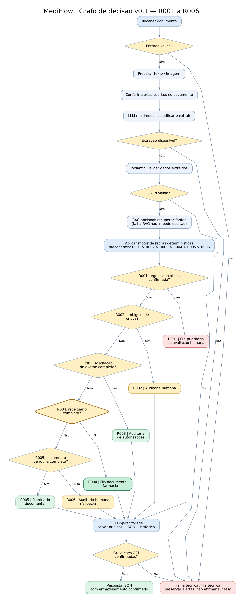

# MediFlow — Triagem documental com IA (Hackathon ONE G10)

**Equipe:** 6 integrantes · **Plano:** 5 semanas · **Contrato atual:** `v0.1`.

O MediFlow é um protótipo educacional de classificação, extração e roteamento de documentos clínicos **sintéticos**. **Não** oferece diagnóstico, prescrição ou decisão médica. **Não está pronto para uso com dados reais.**

## Situação do código

- **Disponível:** estrutura Python, API FastAPI (`GET /health`), validação de entrada JSON no `POST /v1/triagens/texto`, contratos Pydantic/JSON Schema, motor inicial de regras R001–R006, testes e CI no GitHub.
- **Ainda não integrado:** ingestão real de PDF/imagem, processamento por LLM, RAG, grafo LangGraph, Oracle Object Storage, autenticação, interface Streamlit e hospedagem remota.
- Uma entrada válida na rota de triagem retorna **HTTP 501 intencionalmente**; uma entrada inválida retorna **422**. O endpoint `/health` não comprova disponibilidade de IA ou OCI.

## Repositório compartilhado

**GitHub:** https://github.com/No-Country-simulation/G10-BRASIL-EQUIPO17

- `main`: versão estável para demonstrações;
- `develop`: integração de mudanças aprovadas;
- `feat/`, `fix/`, `docs/`, `test/`, `refactor/`, `chore/`: branches temporárias, nomeadas pelo trabalho e **não** pelo dia, data ou nome do integrante.

Veja **[CONTRIBUTING.md](CONTRIBUTING.md)** antes de começar uma alteração.

## Instalação local (Windows / PowerShell)

Pré-requisitos: Git e Python 3.12. Não há dependência de um computador central ligado.

```powershell
git clone https://github.com/No-Country-simulation/G10-BRASIL-EQUIPO17.git
cd G10-BRASIL-EQUIPO17
git switch develop
py -3.12 -m venv .venv
.\.venv\Scripts\python.exe -m pip install -e '.[dev]'
.\.venv\Scripts\python.exe -m pytest -q
.\.venv\Scripts\python.exe -m uvicorn mediflow.api.app:app --reload
```

Acesse `http://127.0.0.1:8000/docs` para testar a API local.

### Linux / macOS

```bash
git clone https://github.com/No-Country-simulation/G10-BRASIL-EQUIPO17.git
cd G10-BRASIL-EQUIPO17
git switch develop
python3.12 -m venv .venv
.venv/bin/python -m pip install -e '.[dev]'
.venv/bin/python -m pytest -q
.venv/bin/python -m uvicorn mediflow.api.app:app --reload
```

## Mapa do projeto

| Local | Responsabilidade |
|---|---|
| `src/mediflow/api/` | API FastAPI |
| `src/mediflow/ingestion/` | Recebimento e preparação dos documentos (planejado) |
| `src/mediflow/extraction/` | Extração de dados por IA (planejada) |
| `src/mediflow/rag/` | Consulta à base de conhecimento (planejada) |
| `src/mediflow/agents/` | Orquestração do grafo (planejada) |
| `src/mediflow/storage/` | Integração OCI (planejada) |
| `src/mediflow/ui/` | Interface Streamlit (planejada) |
| `src/mediflow_contracts/` | Contratos Pydantic e motor inicial de decisões |
| `rules/` e `schemas/` | Regras YAML e JSON Schema gerados |
| `tests/` | Testes automatizados |
| `amostras/` e `exemplos/` | Entradas e saídas de demonstração, exclusivamente sintéticas |
| `docs/` e `diagramas/` | Arquitetura, decisões, fluxos e documentação histórica |

**Atenção:** `schemas/` é gerado a partir dos modelos Pydantic; execute `python scripts/exportar_schemas.py` em vez de editar os schemas manualmente.

## Guia para a equipe

- [CONTRIBUTING.md](CONTRIBUTING.md): nomes de branches, pull requests, testes e segurança.
- [docs/06_mapa_colaboracao.md](docs/06_mapa_colaboracao.md): módulos, papéis e nomes recomendados para entregas.
- [docs/01_arquitetura_monorepo.md](docs/01_arquitetura_monorepo.md): estrutura de software.
- [docs/02_git_colaboracao.md](docs/02_git_colaboracao.md): atalho para o guia Git atualizado.
- [docs/dia02/01_contrato_api.md](docs/dia02/01_contrato_api.md): contrato `v0.1`, referência técnica.
- [docs/03_plano_dia03.md](docs/03_plano_dia03.md): registro histórico de implantação inicial.

> Os nomes com `dia01`, `dia02` e `dia03` preservados **em artefatos históricos e testes existentes** não são exemplos para novas branches. As tags existentes também não precisam ser renomeadas.

## Próximas entregas por funcionalidade

1. `feat/oci-object-storage`: armazenamento privado OCI com teste real de upload/recuperação.
2. `feat/api-document-upload`: endpoint de ingestão PDF/PNG/JPEG, com validação.
3. `feat/ai-document-extraction`: leitura, classificação e extração estruturada.
4. `feat/rag-knowledge-retrieval`: recuperação de referências auditáveis.
5. `feat/rules-routing-engine` e `feat/agent-langgraph-workflow`: decisões condicionais em execução.
6. `feat/ui-document-dashboard` e `feat/ui-human-review`: interface e auditoria.

Os nomes são **sugestões**, não branches já criadas. Comece a partir de `develop` e abra PR para `develop`.

## Arquitetura e fluxo do agente


