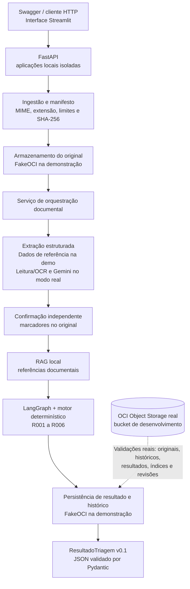
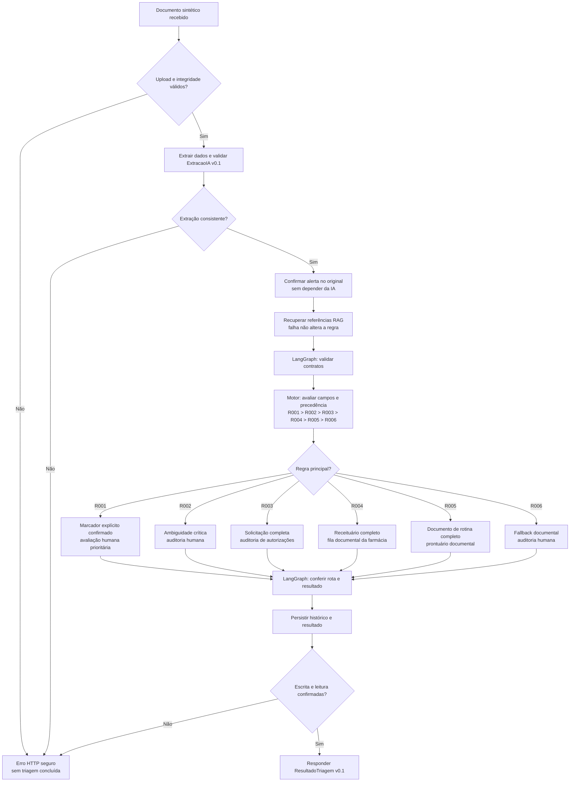

# MediFlow

### Agente de triagem e roteamento documental assistido por IA

**Hackathon ONE — Grupo 10 · Equipe 17**

**Tecnologias principais:** Python · FastAPI · Streamlit · Pydantic · PyMuPDF · Tesseract OCR · Google Gemini · RAG local · LangGraph · Oracle Cloud Infrastructure (OCI)

O **MediFlow** é um protótipo educacional que recebe documentos de saúde **sintéticos**, extrai informações estruturadas, identifica inconsistências e encaminha cada documento a uma **fila administrativa simulada**. O projeto combina reconhecimento óptico de caracteres (OCR), inteligência artificial, regras determinísticas, recuperação de referências (RAG), roteamento condicional e armazenamento auditável. A interface permite acompanhar os resultados e registrar decisões humanas sem substituir a análise original.

> [!IMPORTANT]
> **Não é um sistema clínico.** O MediFlow não diagnostica, prescreve, define condutas, autoriza procedimentos nem dispensa medicamentos. Os dados e documentos de demonstração são fictícios. **Não utilize dados reais de pacientes, não exponha os serviços à internet e não interprete alertas documentais como avaliação médica.**

**Estado atual do projeto — 21/11/2026**

O MediFlow possui um MVP funcional com interface Streamlit, recebimento de arquivos e texto, extração estruturada, roteamento documental e revisão humana. Os três cenários oficiais representam documentos de rotina, sinais de possível urgência e informações ambíguas ou ilegíveis.

- **Demonstração local:** utiliza resultados de extração de referência (fixtures) e armazenamento temporário em memória (FakeOCI). Não exige credenciais externas nem faz chamadas ao Gemini ou à OCI real.
- **Validação integrada com serviços reais:** os três cenários foram processados com Google Gemini e Oracle Cloud Infrastructure (OCI) Object Storage reais, com 12 objetos auditados. Consulte o [relatório da validação integrada](docs/29_h16_homologacao_http_gemini_oci_real.md).
- **Validação de persistência e revisão humana:** em execução posterior, dois exemplos textuais sintéticos foram processados com resultados de referência e OCI real, sem Gemini real. Foram validados índices por status, gravação e recuperação de revisão humana e isolamento de revisões entre reprocessamentos: 14 novos objetos íntegros, 43 objetos auditados no total e 29 históricos preservados por SHA-256. Consulte o [relatório de persistência e revisão humana](docs/31_h17_homologacao_persistencia_oci_real.md).
- **Qualidade automatizada:** 601 testes offline aprovados e três deselecionados, compilação sem erros e integração contínua aprovada em Python 3.12 e 3.13.

As validações reais e a demonstração local são execuções distintas. Não há validação clínica nem autorização para uso com dados reais de pacientes.

## Índice

- [Visão geral e estado do MVP](#visão-geral-e-estado-do-mvp)
- [Arquitetura](#arquitetura)
- [Fluxo de decisão do agente](#fluxo-de-decisão-do-agente)
- [Cenários de demonstração](#cenários-de-demonstração)
- [Tecnologias e organização do projeto](#tecnologias-e-organização-do-projeto)
- [Instalação](#instalação)
- [Executar a demonstração local](#executar-a-demonstração-local)
- [Modos de API e endpoints](#modos-de-api-e-endpoints)
- [Contratos, regras e persistência](#contratos-regras-e-persistência)
- [Diferenças em relação ao exemplo do edital](#diferenças-em-relação-ao-exemplo-do-edital)
- [Testes e evidências](#testes-e-evidências)
- [Segurança e limitações](#segurança-e-limitações)
- [Documentação e colaboração](#documentação-e-colaboração)

## Visão geral e estado do MVP

| Capacidade | Estado verificado |
|---|---|
| Recepção de PDF, PNG, JPEG e texto, com manifesto e SHA-256 | **Implementada**; testes HTTP e validações de integridade |
| OCR e extração estruturada com Google Gemini | **Implementados**; extração com Gemini real validada no fluxo HTTP dos três cenários, com armazenamento simulado |
| Recuperação de referências (RAG) | **Implementada e executada localmente**, com fichas versionadas |
| Confirmação de marcador de alerta no original | **Implementada** com leitura independente da resposta da IA |
| Regras de encaminhamento R001–R006 e LangGraph | **Implementados e testados localmente** |
| Resultado estruturado em `ResultadoTriagem v0.1` | **Implementado** com validação Pydantic |
| Persistência de originais, manifestos, históricos e resultados | **Validada na OCI real** nos três cenários; índices por status e suas referências também validados posteriormente, com 14 novos objetos íntegros |
| Demonstração dos três cenários | **3/3** no modo local simulado, **3/3** com Gemini real e armazenamento simulado e **3/3** com Gemini e OCI reais |
| Interface gráfica (Streamlit) | **Integrada às APIs locais e validada visualmente**: visão geral, envio de arquivo ou texto, resultado com regra e evidências, fila de auditoria e comparação entre extração original e alterações humanas; ver [guia da interface](src/mediflow/ui/README.md) |
| Revisão humana operacional | **Persistência, recuperação e isolamento entre execuções validados na OCI real**, com HTTP 201 após releitura; aprovação, correção e rejeição com alterações validadas offline na interface e API; **revisor sem autenticação** |
| Escopo de uso | **Protótipo educacional**, validado em ambiente controlado com documentos sintéticos |

**Interpretação das evidências:** os testes automatizados e as validações com serviços externos são complementares. Os resultados demonstram o funcionamento documental no escopo controlado, não desempenho clínico.

## Arquitetura

O repositório é um **monorepo Python** organizado por funcionalidades. O serviço de orquestração coordena os adaptadores; **o motor determinístico é a fonte da decisão**, enquanto o LangGraph materializa a rota escolhida. O RAG oferece referências e **não decide** encaminhamentos.



**O que é real em cada execução:**

- **Demonstração local:** FastAPI, integridade, orquestração, confirmador, RAG, motor e LangGraph são implementações reais locais; extração utiliza os JSONs de referência; persistência utiliza FakeOCI **volátil em memória**.
- **Validação de extração com Gemini:** a mesma orquestração utiliza o extrator Gemini mediante autorização explícita. Os testes automatizados usam um extrator controlado e não fazem chamadas externas; a persistência continua em FakeOCI. O [relatório da extração com Gemini real](docs/27_h15_homologacao_http_gemini_real.md) comprova os três cenários com o serviço real.
- **Validação isolada do armazenamento OCI:** o SDK e o Object Storage reais gravaram e leram quatro objetos de um cenário sintético, com resultado de referência. Essa evidência isolada não comprova o fluxo HTTP completo.
- **Validação integrada com Gemini e OCI reais:** fluxo HTTP completo, com consentimentos explícitos e o bucket `mediflow-docs-dev`; os três cenários foram aprovados, com 12 objetos auditados. A gravação de revisão humana não foi testada nessa execução.
- **Validação de persistência e revisão humana na OCI:** dois cenários textuais sintéticos, extração por dados de referência (sem Gemini real), três execuções, três índices por status, uma revisão humana registrada separadamente e reprocessamento sem herança da revisão. Foram auditados 43 objetos, incluindo 14 novos e 29 históricos preservados ([relatório técnico](docs/31_h17_homologacao_persistencia_oci_real.md)).

O armazenamento confirmado no JSON da demonstração **não significa** que um objeto tenha sido enviado à Oracle Cloud.

### Componentes principais

| Componente técnico | Implementação |
|---|---|
| HTTP, ingestão e processamento | `src/mediflow/api/` |
| Orquestração de etapas e contratos | `src/mediflow/api/triage_service.py` |
| Extração de texto, OCR e Gemini | `src/mediflow/extraction/` |
| Recuperação RAG e fichas locais | `src/mediflow/rag/` |
| Validação e roteamento determinístico | `src/mediflow/rules/` e `rules/` |
| Grafo condicional executável | `src/mediflow/agents/grafo_documental.py` |
| Adaptadores e persistência OCI | `src/mediflow/storage/` |
| Contratos JSON/Pydantic v0.1 | `src/mediflow_contracts/` |
| Interface Streamlit e revisão humana | `src/mediflow/ui/` e `src/mediflow/api/triage_review.py` |
| Testes e homologação | `tests/`, `scripts/`, `docs/evidencias/` |

> O grafo LangGraph implementa **o subfluxo condicional de decisão**. Extração, confirmação documental, RAG e persistência são coordenados pelo serviço Python; não há alegação de que todo o pipeline externo esteja dentro de um único grafo.

## Fluxo de decisão do agente

O serviço valida a entrada, executa a extração, confirma independentemente marcadores textuais do documento original, consulta referências locais e entrega os dados ao grafo. O motor lê as regras e os campos mínimos versionados em [`rules/roteamento.yaml`](rules/roteamento.yaml) e [`rules/validacao.yaml`](rules/validacao.yaml).



O LangGraph usa os nós `validar_contratos`, `avaliar_regras`, `rota_R001` a `rota_R006` e `concluir`; a seleção da aresta é condicionada à regra principal calculada pelo motor. **R001 tem prioridade sobre R002** quando um marcador expresso é confirmado no original, preservando a ambiguidade concomitante na validação. Falhas de extração, leitura ou persistência não são tratadas como sucesso. Os destinos são **filas administrativas simuladas**, não integrações hospitalares.

| Regra | Condição documental | Destino | Revisão humana |
|---|---|---|---|
| **R001** | Alerta expresso confirmado independentemente no original | `fila_prioritaria_avaliacao_humana` | Sim |
| **R002** | Campo essencial ilegível, ausente ou conflitante | `auditoria_humana` | Sim |
| **R003** | Solicitação de exame documentalmente completa | `auditoria_autorizacoes` | Não |
| **R004** | Receituário documentalmente completo | `fila_farmacia_documental` | Não |
| **R005** | Documento de rotina documentalmente completo | `prontuario_documental` | Não |
| **R006** | Nenhuma condição anterior atendida, inclusive **indicador de qualidade abaixo do limiar** | `auditoria_humana` | Sim |

A revisão humana começa como **um estado de encaminhamento**. Nas APIs locais, a Fila de auditoria da interface registra a decisão (aprovar, corrigir ou rejeitar) em `POST /v1/triagens/{documento_id}/revisao`, sem alterar o resultado original.

## Cenários de demonstração

Os documentos oficiais de teste são **fictícios** e estão versionados em [`amostras/`](amostras/). A validação da demonstração local executa upload e processamento HTTP, verifica os resultados e gera evidência sanitizada.

| Cenário | Amostra | Regra | Destino | Status |
|---|---|---|---|---|
| **Rotina — DOC-001** | `amostras/pdf/DOC-001_laudo_laboratorial_rotina.pdf` | R005 | `prontuario_documental` | `processado` |
| **Alerta — DOC-002** | `amostras/pdf/DOC-002_laudo_imagem_alerta.pdf` | R001 | `fila_prioritaria_avaliacao_humana` | `aguardando_auditoria` |
| **Ambiguidade — DOC-005** | `amostras/imagens/DOC-005_receita_ilegivel.png` | R002 | `auditoria_humana` | `aguardando_auditoria` |

O DOC-005 preserva a dose ilegível como `null`; **não há preenchimento por suposição**. O DOC-002 depende de confirmação independente do marcador no documento original. Na [validação da demonstração local](docs/26_h14_demonstracao_local.md), os três cenários foram aprovados com extração de referência e armazenamento simulado ([evidência JSON](docs/evidencias/h14_demonstracao_local.json)). Na [validação com Gemini real](docs/27_h15_homologacao_http_gemini_real.md), os três cenários alcançaram as mesmas regras, destinos e status com FakeOCI ([evidência JSON](docs/evidencias/h15_gemini_http_real.json)). A [validação integrada com Gemini e OCI reais](docs/29_h16_homologacao_http_gemini_oci_real.md) também aprovou os três cenários. São evidências distintas, não uma medição de acurácia clínica.

## Tecnologias e organização do projeto

- **Python 3.12/3.13**, FastAPI, Uvicorn, Pydantic e JSON Schema para APIs e contratos.
- **PyMuPDF, pypdf, Pillow e Tesseract OCR (`por`)** para leitura, verificação e OCR de PDFs/imagens.
- **Google Gemini (`google-genai`)** para extração estruturada, com credencial e validação separadas.
- **RAG local** com recuperação de fichas versionadas; não é serviço de busca clínica externa.
- **LangGraph** para validar a decisão e seguir uma das seis rotas condicionais.
- **Oracle Cloud Object Storage (`oci`)** para armazenamento e leitura de originais, manifestos, históricos e resultados, quando expressamente configurado.
- **Streamlit, pandas, requests e Altair** para interface, consulta à API e visualização dos resultados.
- **pytest e GitHub Actions** para regressão e integração contínua em Python 3.12 e 3.13.

```text
.
├── .github/workflows/ci.yml       # CI Python 3.12 e 3.13
├── amostras/                       # PDFs e imagem sintéticos oficiais
├── baseline_dia1/                  # Cenários e gabaritos de referência
├── config/                         # Destinos administrativos simulados
├── docs/                           # Arquitetura, critérios e homologações
│   └── evidencias/                 # Registros técnicos sanitizados
├── exemplos/                       # Dados de referência ExtracaoIA / ResultadoTriagem
├── rules/                          # Regras de roteamento e validação em YAML
├── schemas/                        # JSON Schemas derivados dos modelos
├── scripts/                        # Utilitários e homologações controladas
├── src/
│   ├── mediflow/
│   │   ├── agents/                # LangGraph condicional
│   │   ├── api/                   # FastAPI, composição e orquestração
│   │   ├── extraction/            # OCR e adaptador Gemini
│   │   ├── rag/                   # Recuperador e fichas de referência
│   │   ├── rules/                 # Motor determinístico e confirmação
│   │   ├── storage/               # OCIStorage e persistência
│   │   └── ui/                    # Interface Streamlit (streamlit run src/mediflow/ui/app.py)
│   └── mediflow_contracts/        # Pydantic v0.1 e contratos canônicos
├── tests/                           # Testes de contrato, integração e falha
├── CONTRIBUTING.md                  # Convenções de contribuição
└── pyproject.toml                    # Pacote Python e dependências
```

## Instalação

**Versão a executar:** os comandos utilizam a versão da branch padrão do repositório. Para reproduzir outra versão, selecione a branch ou o commit correspondente antes da instalação.

**Pré-requisitos:** Git, Python **3.12 ou 3.13**, acesso ao repositório e Tesseract OCR com idioma **português (`por`)** para os cenários que envolvem imagens. O pacote Python `pytesseract` **não instala** o executável Tesseract.

### Windows — PowerShell

```powershell
git clone https://github.com/No-Country-simulation/G10-BRASIL-EQUIPO17.git
cd G10-BRASIL-EQUIPO17
py -3.12 -m venv .venv
.\.venv\Scripts\python.exe -m pip install --upgrade pip
.\.venv\Scripts\python.exe -m pip install -e ".[dev,ai,ui]"
tesseract --version
tesseract --list-langs
```

A saída de `tesseract --list-langs` deve incluir `por`. Se o executável não for encontrado, instale-o no Windows, habilite os dados de idioma português e acrescente a pasta de instalação ao `PATH`.

### Linux (Ubuntu/Debian)

```bash
sudo apt-get update
sudo apt-get install -y tesseract-ocr tesseract-ocr-por
git clone https://github.com/No-Country-simulation/G10-BRASIL-EQUIPO17.git
cd G10-BRASIL-EQUIPO17
python3.12 -m venv .venv
.venv/bin/python -m pip install --upgrade pip
.venv/bin/python -m pip install -e '.[dev,ai,ui]'
```

A instalação **não exige chave Gemini nem credenciais OCI** para executar a demonstração local e seus testes. O extra `ui` instala as dependências da interface. O extra `cloud` (`.[dev,ai,ui,cloud]` para uma instalação que também inclua a interface) destina-se apenas às operações autorizadas com a Oracle Cloud real.

## Executar a demonstração local

Este é o **modo recomendado para reproduzir o MVP demonstrativo**. Arquivos devem corresponder aos nomes e bytes originais das três amostras oficiais; o modo de texto aceita o conteúdo das amostras textuais oficiais. Não há chamada ao Gemini nem gravação OCI real.

### 1. Iniciar a API de demonstração

No PowerShell, na raiz do repositório:

```powershell
$env:MEDIFLOW_ENV = "development"
$env:MEDIFLOW_ENABLE_LOCAL_UPLOADS = "true"
$env:MEDIFLOW_ENABLE_LOCAL_TRIAGE = "true"
$env:MEDIFLOW_ENABLE_LOCAL_DEMO = "true"
$env:MEDIFLOW_ENABLE_LOCAL_GEMINI = "false"
$env:MEDIFLOW_ENABLE_LOCAL_OCI = "false"

.\.venv\Scripts\python.exe -m uvicorn mediflow.api.app_demo_local:app --host 127.0.0.1 --port 8000
```

No Linux, na raiz do repositório:

```bash
export MEDIFLOW_ENV=development
export MEDIFLOW_ENABLE_LOCAL_UPLOADS=true
export MEDIFLOW_ENABLE_LOCAL_TRIAGE=true
export MEDIFLOW_ENABLE_LOCAL_DEMO=true
export MEDIFLOW_ENABLE_LOCAL_GEMINI=false
export MEDIFLOW_ENABLE_LOCAL_OCI=false
.venv/bin/python -m uvicorn mediflow.api.app_demo_local:app --host 127.0.0.1 --port 8000
```

Abra `http://127.0.0.1:8000/docs` para o Swagger e `http://127.0.0.1:8000/demo/estado` para identificar o modo. **Não utilize `--reload`, múltiplos workers, proxies, túneis ou `0.0.0.0`**: a FakeOCI é volátil e a aplicação não possui autenticação pública.

### 2. Enviar um documento

**Pela interface visual:** mantenha a API em execução e abra outro terminal na raiz do repositório.

Windows (PowerShell):

```powershell
$env:MEDIFLOW_API_URL = "http://127.0.0.1:8000"
.\.venv\Scripts\python.exe -m streamlit run src/mediflow/ui/app.py --server.address 127.0.0.1 --server.port 8501
```

Linux:

```bash
export MEDIFLOW_API_URL=http://127.0.0.1:8000
.venv/bin/python -m streamlit run src/mediflow/ui/app.py --server.address 127.0.0.1 --server.port 8501
```

Abra `http://127.0.0.1:8501`, acesse **Enviar documento**, selecione uma amostra oficial de `amostras/` como arquivo ou use um dos exemplos de **Texto livre**. Após processar, consulte **Resultado da análise**. Os casos sinalizados entram na **Fila de auditoria**, onde o revisor pode registrar aprovação, correção ou rejeição. A extração original permanece separada das alterações humanas. O indicador **Finalizados** inclui os documentos processados automaticamente e as revisões concluídas, inclusive rejeições.

Um arquivo fora das amostras autorizadas é recusado no modo demonstrativo antes da persistência, com HTTP 422 e mensagem específica. Mais detalhes no [guia da interface](src/mediflow/ui/README.md).

**Pela linha de comando:** em **outro PowerShell**, posicionado na raiz do repositório:

```powershell
$recibo = curl.exe -sS -X POST "http://127.0.0.1:8000/v1/triagens/arquivos" `
  -F "documento_id=DOC-001" `
  -F "canal_origem=demo_local" `
  -F "arquivo=@amostras/pdf/DOC-001_laudo_laboratorial_rotina.pdf;type=application/pdf" |
  ConvertFrom-Json

$recibo.arquivo_id
```

Resposta esperada do upload: **HTTP 201**, com `arquivo_id` gerado e `triagem_executada=false` no recibo. O upload **ainda não processa** o documento.

### 3. Executar a triagem e consultar a decisão

```powershell
$resultado = Invoke-RestMethod -Method Post `
  -Uri "http://127.0.0.1:8000/v1/triagens/arquivos/DOC-001/$($recibo.arquivo_id)/processar"

$resultado.decisao_roteamento.regra_principal
$resultado.decisao_roteamento.destino_principal
$resultado.status
```

Para DOC-001, o esperado é **`R005`**, **`prontuario_documental`** e **`processado`**. Para inspecionar o contrato inteiro:

```powershell
$resultado | ConvertTo-Json -Depth 16
```

A estrutura inclui `classificacao`, `dados_extraidos`, `validacao`, `evidencias`, `rag`, `decisao_roteamento`, `armazenamento_oci` e `eventos`. O campo `armazenamento_oci.status="confirmado"` representa **apenas a FakeOCI neste modo**.

### 4. Executar os três cenários e gerar a evidência da demonstração local

Não é necessário iniciar o Uvicorn; o script usa `TestClient` internamente:

```powershell
.\.venv\Scripts\python.exe -m pytest -q tests/test_h14_demonstracao_local.py -rx
.\.venv\Scripts\python.exe scripts/homologar_h14_demo_local.py
```

O script de homologação é opcional e registra **3/3 cenários** em `docs/evidencias/h14_demonstracao_local.json`. Sua execução pode substituir a evidência versionada. Para apenas reproduzir os testes, execute o comando `pytest` acima; o [relatório da demonstração local](docs/26_h14_demonstracao_local.md) contém a evidência já produzida.

## Modos de API e endpoints

O projeto contém **quatro aplicações FastAPI distintas**. Elas não são intercambiáveis e não devem ser publicadas sem autenticação/autorização.

| Aplicação | Inicialização | O que faz | Limitação |
|---|---|---|---|
| **API de desenvolvimento** | `mediflow.api.app:app` | Saúde, upload/consulta em OCI configurada, preview e rota isolada de extração Gemini | **Não** processa triagem; `POST /v1/triagens/texto` responde 501 aqui (use os apps locais) |
| **Demonstração local** | `mediflow.api.app_demo_local:app` | Upload + processamento dos três arquivos oficiais **ou do texto deles**; RAG/regras/LangGraph reais locais | Extração por fixtures; FakeOCI em memória |
| **Homologação Gemini local** | `mediflow.api.app_gemini_local:app` | Composição HTTP com extrator Gemini injetável | Gemini real bloqueado por padrão; FakeOCI; somente amostras oficiais |
| **Validação integrada com Gemini e OCI reais** | `mediflow.api.app_h16_local:app` | Upload, processamento, fila e revisão humana com Gemini real e bucket OCI `mediflow-docs-dev` | Exige consentimentos explícitos; somente amostras oficiais; revisor sem autenticação. Ver [preparação e controles](docs/28_h16_preparacao_http_gemini_oci.md) |

**Endpoints da demonstração (`app_demo_local`)**:

| Método | Rota | Função |
|---|---|---|
| `GET` | `/demo/estado` | Identifica componentes reais e simulados |
| `POST` | `/v1/triagens/arquivos` | Recebe arquivo em `multipart/form-data` (`documento_id`, `canal_origem`, `arquivo`) |
| `GET` | `/v1/triagens/arquivos/{documento_id}/{arquivo_id}` | Consulta o recibo de upload, **não** o resultado de triagem |
| `GET` | `/v1/triagens/arquivos/{documento_id}` | Lista arquivos com paginação (`limite`, `cursor`) |
| `POST` | `/v1/triagens/arquivos/{documento_id}/{arquivo_id}/processar` | Devolve `ResultadoTriagem v0.1` |
| `POST` | `/v1/triagens/texto` | Recebe `EntradaTexto` em JSON (`documento_id`, `canal_origem`, `documento_texto`), grava o texto como original `.txt` e devolve `ResultadoTriagem v0.1` |
| `GET` | `/v1/triagens?status=` | Lista as triagens persistidas (filtro opcional por status do contrato) |
| `GET` | `/v1/triagens/{documento_id}` | Consulta o último resultado, com `recebido_em` e `revisao_humana` |
| `POST` | `/v1/triagens/{documento_id}/revisao` | Registra `aprovar`, `corrigir` ou `rejeitar`; o resultado original não é alterado |

As três últimas rotas (revisão humana) também existem na aplicação de validação Gemini com armazenamento simulado e na aplicação de validação integrada com Gemini e OCI reais (gravando no bucket de desenvolvimento). **Não** são registradas na API de desenvolvimento.

**Triagem por texto:** a rota `POST /v1/triagens/texto` existe na demonstração local e na homologação Gemini local. O texto vira um original `.txt` (UTF-8, quebras normalizadas) com manifesto, e segue o mesmo pipeline do arquivo: extração, confirmação independente do alerta **no texto original**, RAG, regras/LangGraph e persistência. Como nos arquivos, **só são aceitas as amostras sintéticas oficiais**, aqui em [`amostras/texto/`](amostras/texto/) (texto extraído dos três originais), reconhecidas pelo conteúdo; outro texto é recusado **antes da gravação** com **422 `TEXTO_NAO_AUTORIZADO`**, sem ir ao Gemini. Exemplo (demonstração local):

```powershell
$texto = Get-Content amostras/texto/DOC-002_laudo_imagem_alerta.txt -Raw -Encoding utf8
$corpo = @{ documento_id = "TXT-DOC-002"; canal_origem = "demo_texto"; documento_texto = $texto } | ConvertTo-Json
Invoke-RestMethod -Method Post -Uri http://127.0.0.1:8000/v1/triagens/texto -ContentType "application/json; charset=utf-8" -Body ([Text.Encoding]::UTF8.GetBytes($corpo))
```

A aba **Texto livre** da interface Streamlit usa essa rota.

**Outras rotas:** na API de desenvolvimento, `GET /health` comprova apenas disponibilidade HTTP, `POST /v1/triagens/texto` responde **501** (a triagem só existe nos apps locais) e `POST /v1/triagens/arquivos/{documento_id}/{arquivo_id}/extracao` usa o adaptador Gemini quando há OCI e credenciais configuradas. Na aplicação de homologação Gemini, `GET /gemini/estado` indica configuração/autorização, **não** sucesso da API externa; sem consentimento explícito, `/processar` retorna **503 `GEMINI_REAL_NAO_AUTORIZADO`**. Veja [documentação do modo controlado](docs/25_homologacao_gemini_local_fakeoci.md).

**Limites atuais do upload:** PDF/PNG/JPEG, até **10 MiB** e PDFs com até **10 páginas**, incluindo verificações de extensão, MIME, assinatura e estrutura. Não há ingestão completa de textos/JSONs arbitrários na rota de processamento atual.

## Contratos, regras e persistência

A fonte canônica do JSON é [`src/mediflow_contracts/models.py`](src/mediflow_contracts/models.py). Os arquivos de [`schemas/`](schemas/) derivam dos modelos Pydantic; atualize-os por [`scripts/exportar_schemas.py`](scripts/exportar_schemas.py), não manualmente.

- **`ExtracaoIA`**: categoria, dados estruturados, evidências literais e sinais documentais.
- **`RecuperacaoRAG`**: status de consulta e referências versionadas (`fonte_id`, título, URL e trecho quando disponíveis).
- **`ResultadoTriagem`**: entrada, classificação, integridade, evidências, fontes, decisão, armazenamento e eventos.
- **`IndicadorQualidade`**: score de **qualidade documental da extração**, `metodo="heuristica_completude_consistencia_v0"`, `valor` entre 0 e 1 e `calibrado=false`. **Não é confiança clínica nem probabilidade calibrada.**

#### Score de qualidade e fallback para revisão humana

O motor calcula o indicador em todo processamento, com pesos fixos e critérios explicados no próprio resultado (`classificacao.indicador_qualidade.criterios`):

| Critério | Peso | Medida |
|---|---|---|
| Completude | 0,5 | campos mínimos da categoria legíveis (`rules/validacao.yaml`) |
| Ancoragem em evidências | 0,3 | campos mínimos com trecho literal do original em `evidencias` |
| Consistência | 0,1 | ausência de campos conflitantes |
| Profissional identificado | 0,1 | nome do profissional presente |

Categoria `outro_desconhecido` recebe 0. **Fallback:** quando o valor fica abaixo de `indicador_qualidade.limiar_revisao_humana` (padrão **0,75**, configurável em [`rules/validacao.yaml`](rules/validacao.yaml) entre 0,5 e 1,0), um documento que seria de rotina (R003–R005) é desviado para **R006 → `auditoria_humana`**, com observação na validação e evento `FALLBACK_QUALIDADE_BAIXA`. O indicador **nunca rebaixa** R001 nem substitui R002. Nos três cenários oficiais, com as fixtures, os valores são 0,85 (DOC-001), 0,90 (DOC-002) e 0,73 (DOC-005, já em R002).

O motor usa **precedência fixa** R001 → R006, incluindo as validações de campos V001–V004. Não cria CID, diagnósticos, doses ou páginas por inferência, e não apresenta o indicador de qualidade como confiança clínica. Falhas de RAG são registradas e não alteram a decisão; falhas de extração, integridade ou persistência podem encerrar a operação com erro HTTP sanitizado.

### Organização dos objetos no armazenamento

O adaptador utiliza chaves no formato:

```text
bucket/
├── originais/<documento_id>/<arquivo_id>.<ext>
├── metadados/<documento_id>/<arquivo_id>.json
├── historicos/<documento_id>/<arquivo_id>/<execucao_id>.json
├── resultados/<documento_id>/<arquivo_id>/<execucao_id>.json
├── processados/<destino>/<documento_id>/<arquivo_id>/<execucao_id>.json
├── auditoria_humana/<destino>/<documento_id>/<arquivo_id>/<execucao_id>.json
└── revisoes/<documento_id>/<revisao_id>.json
```

**Segregação por status:** a validação real utiliza **um bucket de desenvolvimento com prefixos segregados**, não vários buckets independentes. `originais/` guarda os documentos **recebidos**. Depois de confirmar histórico e resultado, a persistência grava um **índice por status e destino**: `processados/` para roteamento automático (ex.: `processados/prontuario_documental/...`) e `auditoria_humana/` para tudo que exige revisão humana, inclusive a fila prioritária (ex.: `auditoria_humana/fila_prioritaria_avaliacao_humana/...`). O índice aponta para as chaves do original, do resultado e do histórico. Se a gravação do índice falhar, a persistência **não** é confirmada. Cada decisão de revisão humana é gravada como objeto imutável em `revisoes/`, sem alterar o resultado original.

O upload gera um `arquivo_id` por recebimento; a persistência gera um `execucao_id` por processamento. A escrita de histórico e resultado utiliza criação condicional, leitura de retorno e verificação de integridade. **Falha parcial não é sucesso** e pode exigir reconciliação operacional; não há limpeza destrutiva automática. Reprocessar um documento pode criar outra execução: **as APIs locais não oferecem idempotência**. A consulta `GET /v1/triagens/{documento_id}` devolve apenas o último resultado de cada documento e só existe nas aplicações locais, sem autenticação.

A [validação isolada do armazenamento OCI](docs/17_homologacao_h09_persistencia_oci_real.md) documenta uma execução real controlada em 08/11/2026, com quatro objetos associados ao DOC-001 sintético e decisão proveniente de dados de referência. O script [`scripts/homologar_h09_oci_real.py`](scripts/homologar_h09_oci_real.py) possui um **modo de planejamento sem gravação**; executar com `--execute` escreve novos objetos reais e exige autorização explícita, validação de credenciais e avaliação dos limites/custos OCI.

## Diferenças em relação ao exemplo do edital

O edital mostra um exemplo de requisição e de resposta (caso de TEP agudo). O MediFlow atende aos mesmos requisitos, mas **muda de propósito alguns nomes e campos** para não produzir informação clínica que o documento não contém. A tabela abaixo indica, para cada campo do exemplo, onde a informação aparece no `ResultadoTriagem` v0.1 e por que mudou.

### Requisição

| Campo do edital | No MediFlow | Motivo |
|---|---|---|
| `documento_id` | `documento_id` (mesmo nome) | — |
| `documento_texto` | `documento_texto` em `POST /v1/triagens/texto` | — |
| `canal_origem` | `canal_origem` (mesmo nome) | — |
| `tipo_arquivo` | **Aceito, mas ignorado** (opcional, até 20 caracteres). O tipo real vem do servidor em `entrada.tipo_entrada` (`texto`, `pdf`, `png`, `jpeg`); no upload, ele é deduzido pela extensão e conferido com o MIME e a assinatura do arquivo | Não confiar no tipo declarado pelo cliente. O campo existe só para que o JSON do exemplo do edital seja aceito sem erro; qualquer outro campo desconhecido continua retornando **422** |

PDF e imagem não chegam como texto no JSON: são enviados por upload (`multipart/form-data`) e processados depois pelo `documento_id`/`arquivo_id` (ver [Executar a demonstração local](#executar-a-demonstração-local)).

### Resposta

| Campo do edital | No MediFlow | Motivo |
|---|---|---|
| `status: "processado"` | `status`: `processado` (roteamento automático) ou `aguardando_auditoria` (qualquer caso com revisão humana, inclusive alerta) | A triagem automatizada foi executada, mas o documento ainda aguarda avaliação humana |
| `classificacao.tipo_documento: "Laudo de Exame de Imagem"` | `classificacao.tipo_documento: "laudo_imagem"` (lista fechada: `receituario`, `laudo_laboratorial`, `laudo_imagem`, `solicitacao_exame`, `relatorio_alta`, `atestado`, `outro_desconhecido`) | Valores canônicos que as regras e os testes podem comparar sem ambiguidade |
| `classificacao.especialidade` | `classificacao.especialidade_texto` | Apenas transcrita quando aparece no documento; senão fica `null` |
| `classificacao.nivel_prioridade: "Urgente"` | `classificacao.nivel_prioridade_documental`: `rotina`, `possivel_urgencia` ou `indeterminada` | O sistema não faz avaliação clínica. Ele só registra que o **texto** traz um marcador de alerta, confirmado no original |
| `classificacao.score_confianca_classificacao: 0.99` | `classificacao.indicador_qualidade` (`valor` 0–1, `metodo`, `criterios`, `calibrado: false`) | A LLM não fornece probabilidade calibrada. O indicador mede completude, evidências e consistência da extração e, abaixo de 0,75, desvia o documento para revisão humana (ver [Score de qualidade](#score-de-qualidade-e-fallback-para-revisão-humana)) |
| `dados_extraidos.paciente` | `dados_extraidos.paciente` (`nome`, `idade`, `identificador` e o estado de cada campo: `legivel`, `ausente`, `ilegivel`, `conflitante`) | O estado do campo permite mandar para auditoria em vez de adivinhar |
| `dados_extraidos.medico_solicitante` (`nome`, `crm`) | `dados_extraidos.profissional` (`nome`, `crm_texto`) | O CRM é apenas transcrito; não há validação no conselho |
| `dados_extraidos.exame_realizado` | `dados_extraidos.exame.nome` (mais `achados`, `conclusao` e `resultados`) | Estrutura comum a laudos de imagem e laboratoriais |
| `dados_extraidos.diagnostico_principal` | `dados_extraidos.exame.conclusao` (texto literal do laudo) | O sistema **não formula diagnóstico**; repete o que o documento diz |
| `dados_extraidos.cid_sugerido: "I26.9"` | `dados_extraidos.cid_documentado` (somente se o CID estiver escrito no documento; senão `null`) | **Sugerir CID é codificação clínica.** O MediFlow não cria CID por inferência |
| `decisao_roteamento.destino_principal: "Fila_Emergencia_Medica"` | `decisao_roteamento.destino_principal`, um destes: `fila_prioritaria_avaliacao_humana`, `auditoria_humana`, `auditoria_autorizacoes`, `fila_farmacia_documental`, `prontuario_documental`, `fila_erros_tecnicos` | As filas são administrativas e simuladas. A "emergência" vira fila **prioritária de avaliação humana**: quem decide a conduta é uma pessoa |
| `decisao_roteamento.requer_auditoria_humana: false` | `decisao_roteamento.requer_revisao_humana` | No caso de alerta, o valor é **`true`**: um marcador de alerta confirmado exige revisão humana |
| `decisao_roteamento.justificativa_roteamento` | `decisao_roteamento.justificativa`, mais `regra_principal` (R001–R006), `regras_disparadas` e `versao_regras` | A decisão fica auditável e pode ser reproduzida pela regra versionada |
| `decisao_roteamento.notificacao_gerada` (`canal`, `mensagem`) | `decisao_roteamento.alertas` (`codigo`, `mensagem`), por exemplo `ALERTA_DOCUMENTAL` | O alerta documental é registrado e consultável no resultado; não representa uma notificação enviada a serviços externos |
| `armazenamento_oci.bucket` | `armazenamento_oci.bucket` | — |
| `armazenamento_oci.caminho_objeto: "processados/urgentes/…"` | `chave_original`, `chave_resultado` e `chave_historico`, mais um índice em `processados/<destino>/…` ou `auditoria_humana/<destino>/…` | Original, resultado e histórico ficam separados e com integridade verificada (ver [Organização dos objetos](#organização-dos-objetos-no-armazenamento)) |
| `armazenamento_oci.status_backup: "sucesso"` | `armazenamento_oci.status`: `pendente`, `confirmado` ou `falha` | Só vira `confirmado` depois da gravação **e** da releitura com sucesso; falha parcial nunca aparece como sucesso |
| — | Campos a mais: `validacao` (campos ausentes, ilegíveis e conflitantes), `evidencias` (trecho literal e página, quando disponível), `rag` (fontes consultadas) e `eventos` (histórico da execução) | Rastreabilidade de cada decisão |

**Resumo:** o exemplo do edital apresenta campos como CID sugerido, prioridade urgente e encaminhamento para emergência. O MediFlow adota um contrato voltado à **automação documental administrativa**: extrai o que está escrito, prioriza documentos com marcador de alerta confirmado e mantém as decisões clínicas sob responsabilidade humana. Para consultar o cenário equivalente, veja [`exemplos/DOC-002_resultado.json`](exemplos/DOC-002_resultado.json), regra R001.

## Testes e evidências

A suíte automatizada cobre contratos, integridade, roteamento, RAG, LangGraph, HTTP, persistência e falhas parciais. A CI em [`.github/workflows/ci.yml`](.github/workflows/ci.yml) executa testes em **Python 3.12 e 3.13** com o Tesseract disponível.

**Windows / PowerShell:**

```powershell
.\.venv\Scripts\python.exe -m pytest -q tests/test_http_demo_local.py tests/test_h14_demonstracao_local.py -rx
.\.venv\Scripts\python.exe -m pytest -q -k "not fluxo_api_com_gemini_real"
.\.venv\Scripts\python.exe -m compileall -q src scripts tests
```

**Linux / macOS:**

```bash
.venv/bin/python -m pytest -q tests/test_http_demo_local.py tests/test_h14_demonstracao_local.py -rx
.venv/bin/python -m pytest -q -k 'not fluxo_api_com_gemini_real'
.venv/bin/python -m compileall -q src scripts tests
```

**Validação consolidada (20/11/2026):** **601 testes offline aprovados e 3 deselecionados**, compilação sem erros e integração contínua aprovada em Python 3.12 e 3.13. Os testes excluídos da regressão offline são os que envolvem Gemini real. Os relatórios abaixo documentam separadamente as validações com serviços externos e os ensaios controlados.

**Documentos de evidência:**

- [Critérios técnicos de aceite do MVP](docs/16_criterios_homologacao_mvp.md)
- [Validação isolada da persistência OCI real](docs/17_homologacao_h09_persistencia_oci_real.md)
- [Testes de falhas parciais com armazenamento simulado](docs/18_homologacao_h10_falhas_parciais_i1.md)
- [Controles de processamento local](docs/19_h11_controles_processamento_local_i1.md)
- [Tratamento seguro de erros da API](docs/20_h12_tratamento_seguro_erros_api_i1.md)
- [Validação da demonstração local nos três cenários](docs/26_h14_demonstracao_local.md)
- [Validação HTTP com Gemini real e armazenamento simulado](docs/27_h15_homologacao_http_gemini_real.md)
- [Validação integrada com Gemini e OCI reais (3/3 cenários)](docs/29_h16_homologacao_http_gemini_oci_real.md)
- [Validação OCI de índices, revisão humana e reprocessamento (2 cenários, 3 execuções)](docs/31_h17_homologacao_persistencia_oci_real.md)

## Segurança e limitações

- **Somente documentos sintéticos:** nunca submeter prontuários, documentos pessoais ou outros dados reais de pacientes.
- **Somente localhost:** flags de desenvolvimento e restrição a `127.0.0.1` **não substituem autenticação/autorização**. Não publicar por domínio, proxy, túnel, container exposto ou rede interna sem controles adicionais.
- **Credenciais:** não versionar `.env`, `GEMINI_API_KEY`, `~/.oci/config`, PEM, tokens, OCIDs sensíveis ou logs com segredos. Usar identidades OCI individuais e menor privilégio.
- **Uso de serviços externos:** chamadas Gemini e gravações OCI só devem ocorrer em ambiente controlado, com autorização explícita e análise de quota, custo, retenção e elegibilidade Always Free. Os testes offline não consomem esses serviços.
- **Inferência e confiança:** não gerar ou exibir precisão clínica calibrada inexistente; preservar valores ausentes ou ilegíveis e evidências verificáveis.
- **Revisão humana:** a decisão do auditor é registrada nas APIs locais, mas o nome do revisor é declarativo (sem autenticação) e não há notificações em tempo real. Não é um workflow de aprovação clínica.
- **Persistência demonstrativa:** FakeOCI é reiniciada a cada processo; múltiplos workers e recarregamento automático podem perder ou dividir os dados.
- **Integridade e falhas:** há verificações de hash, associação documento/arquivo e erros sanitizados; isso não substitui auditoria de segurança, antivírus, monitoramento operacional, retenção, autorização e política de dados.

## Documentação e colaboração

- [Desafio e critérios de aceite do MVP](docs/16_criterios_homologacao_mvp.md)
- [API demonstrativa local](docs/24_endpoint_http_demo_local.md)
- [Homologação Gemini controlada](docs/25_homologacao_gemini_local_fakeoci.md)
- [Demonstração local e checklist de interface](docs/26_h14_demonstracao_local.md)
- [Guia de contribuição](CONTRIBUTING.md)
- [Histórico de alterações e pull requests](https://github.com/No-Country-simulation/G10-BRASIL-EQUIPO17/pulls)

**Equipe:** cinco integrantes atuaram nas frentes de arquitetura e API, extração documental, recuperação de referências, regras e roteamento, infraestrutura e armazenamento, interface e qualidade.

Para desenvolver ou contribuir com o projeto, consulte o [guia de contribuição](CONTRIBUTING.md). Os relatórios técnicos preservam os registros originais das validações.

---

**MediFlow — Hackathon ONE G10.** Protótipo educacional de automação documental com roteamento rastreável, evidências estruturadas e revisão humana em casos prioritários ou ambíguos.
