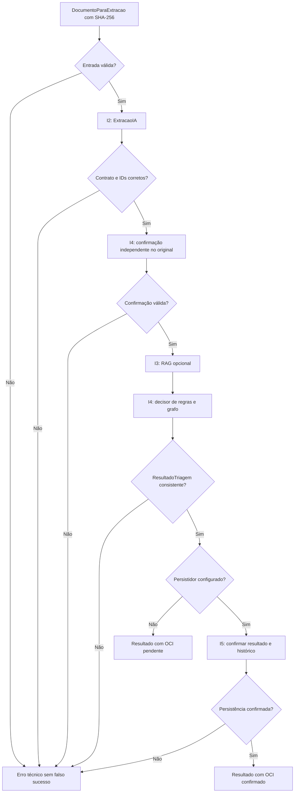

# MediFlow — Orquestração de integração I1 (incremento preparatório)

**Estado:** implementação isolada e testes com adaptadores simulados. Não integra Gemini real, RAG real, motor LangGraph, OCI real, nem publica endpoint. Somente documentos **sintéticos**. **Não é software de uso clínico.**

## Objetivo e limites

Criar uma camada de coordenação entre o documento original verificado (`DocumentoParaExtracao`) e o contrato final (`ResultadoTriagem v0.1`), mantendo dependências injetáveis e a responsabilidade dos módulos:

| Área | Contrato e responsabilidade |
|---|---|
| I1 | `ServicoTriagem` coordena as etapas e impede estados/associações inconsistentes. Não decide regras. |
| I2 | `ExtratorDocumento.extrair(documento) -> ExtracaoIA` (interface existente em `extraction/port.py`). |
| I3 | Adaptador `ProvedorRAG.buscar(extracao) -> RecuperacaoRAG`; o PR #16 expõe `ConsultaRAG` e `RecuperadorPorPalavras` — uma ponte será feita após o merge. |
| I4 | `ConfirmadorAlerta.confirmar(documento) -> bool` **independente da LLM** e `DecisorTriagem.decidir(...) -> ResultadoTriagem`; o grafo/regras executáveis continuam com I4. |
| I5 | `PersistidorTriagem.persistir(resultado) -> ResultadoTriagem`; o adaptador real deve possuir o recibo validado e utilizar a função `persistir_resultado(storage, recibo, resultado)` do PR #15, **após o merge e homologação**. |

A API (`app.py`/`uploads.py`) continua inalterada. Não existe novo endpoint de processamento nesta entrega. A rota `/extracao-preview` não deve ser convertida silenciosamente em IA real.

## Fluxo pretendido da orquestração



**Nota:** a falha opcional do RAG é registrada como `rag.status='falha'` e não substitui a decisão do I4. Marcador de urgência gerado apenas pela LLM **não** habilita R001; o confirmador é separado, analisa o original e deve ser desenvolvido/homologado pelo I4. Este serviço exige que alerta confirmado implique R001 e impede R001 sem confirmação.

## Como usar em testes isolados

Os testes fornecem `ExtratorFake`, `ConfirmadorFake`, `RAGFake`, `DecisorFake` e `PersistidorFake`. O decisor fake chama `gerar_exemplo_de_contrato` (simulação histórica do contrato) **somente** para exercitar as interfaces, sem fingir que LangGraph foi implementado. Os bytes de entrada nos testes também são sintéticos e não são PDFs/PNGs válidos; nenhum OCR é realizado.

```powershell
# Dentro do repositório, na branch feat/api-triage-orchestration:
.\.venv\Scripts\python.exe -m pytest -q tests/test_triage_service.py
.\.venv\Scripts\python.exe -m pytest -q
.\.venv\Scripts\python.exe -m compileall -q src scripts tests
```

**Critérios de aceite deste incremento:**

1. `DOC-001` resulta em R005/`prontuario_documental` usando exemplos controlados.
2. `DOC-002` resulta em R001/fila prioritária **somente** quando o confirmador simulado encontra marcador separado nos bytes de teste.
3. `DOC-005` resulta em R002/`auditoria_humana` com extração sintética incompleta.
4. `documento_id` e SHA-256 divergentes interrompem o fluxo antes de efeitos externos.
5. O RAG falho fica registrado e não provoca decisão por LLM.
6. Sem persistidor, `armazenamento_oci.status` permanece `pendente`.
7. Uma persistência não confirmada interrompe o fluxo; a simulação de persistência **não** comprova gravação Oracle.
8. Saídas que alterem o contrato, a extração, os identificadores, o RAG ou o roteamento são rejeitadas.

## Acoplamento futuro, após merges

1. **I2 / PR #14:** implementar adaptador real da interface `ExtratorDocumento`, com seus limites de OCR/Gemini e testes com documentos sintéticos.
2. **I3 / PR #16:** criar adaptador que transforme os campos documentais pertinentes em `ConsultaRAG` e invoque `RecuperadorPorPalavras.buscar(consulta)`. Não utilizar texto recuperado como prova da existência de urgência no original.
3. **I4 / LangGraph:** implementar o `DecisorTriagem` como executor do fluxo validado e o `ConfirmadorAlerta` em lógica determinística independente. Não duplicar as regras R001–R006 no I1.
4. **I5 / PR #15:** adaptar `persistir_resultado(storage, recibo, resultado)` para `PersistidorTriagem`, associando o documento ao recibo confiável e verificando integridade; testar com fake OCI antes de usar o bucket real.
5. **I1 / API:** publicar endpoint *distinto* do preview, protegido e com erros sanitizados. Não expor serviço publicamente sem autenticação/autorização, limitação de uso e demais proteções.
6. **I6:** conectar interface de revisão humana e estados de auditoria com registros sintéticos. Não confundir pendência humana com processamento final aprovado.

## Observações de segurança

- Este serviço não autentica usuários. A responsabilidade fica na borda da API e no deploy futuro.
- As interfaces são contratos de programação; por si só não garantem a qualidade dos adaptadores de terceiro.
- `FalhaOrquestracao` apresenta código e etapa sem mostrar texto clínico, chaves de armazenamento ou erros remotos.
- O resultado do `PersistidorFake` só comprova o contrato do retorno em testes. O estado `confirmado` do ambiente real somente pode ser emitido pelo adaptador I5 que verificou efetivamente a OCI.
- Os resultados são sintéticos e não representam avaliação, prescrição, diagnóstico ou decisão clínica.
- O I1 não altera `models.py`, schemas, YAMLs, endpoints existentes nem código dos PRs #14/#15/#16.
