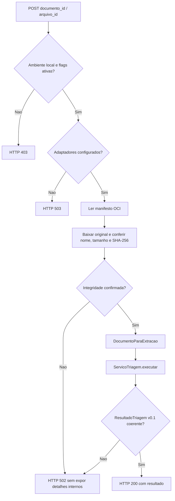

# MediFlow — API de processamento documental (I1, incremento preparatório)

**Situação:** router HTTP isolado e testes com dependências simuladas. Ainda **não** registrado em `src/mediflow/api/app.py`, nem conectado à extração Gemini (I2), ao RAG (I3), ao grafo LangGraph (I4) ou à persistência final OCI (I5). Exclusivamente documentos **sintéticos**, sem uso clínico.

## 1. Objetivo

Preparar a entrada HTTP para o `ServicoTriagem` implementado no PR #18, aproveitando o recibo de upload já persistido na OCI. Esta etapa **não reimplementa** a extração, as regras ou a persistência, e não altera arquivos nos PRs #14, #15 e #16.

Arquivos do incremento:

| Arquivo | Função |
|---|---|
| `src/mediflow/api/triage_processing.py` | Router HTTP, verificação do original, guardas locais e tradução de erros |
| `tests/test_api_triage_processing.py` | Testes de interface, segurança e integridade com OCI/serviço simulados |
| `docs/12_api_processamento_triagem.md` | Contrato, limites, fluxo e critérios de integração |

## 2. Contrato HTTP planejado

```http
POST /v1/triagens/arquivos/{documento_id}/{arquivo_id}/processar
```

Sem body: a referência é o **arquivo previamente armazenado**, identificado por `documento_id` e `arquivo_id`. O upload continua independente; **não** dispara processamento automaticamente.

- `documento_id`: entre 3 e 64 caracteres, padrão `[A-Za-z0-9][A-Za-z0-9-]*`.
- `arquivo_id`: UUID4 em hexadecimal minúsculo, 32 caracteres, padrão `[a-f0-9]{32}`.
- Retorno `200`: `ResultadoTriagem` validado no contrato Pydantic `v0.1`. Sem persistidor, `armazenamento_oci.status = pendente`. `status=aguardando_auditoria` não equivale a aprovação humana.
- Não há autenticação, idempotência de chamadas, rate limiting ou processamento assíncrono implementados. A repetição do POST poderá repetir trabalho quando adaptadores reais forem conectados: resolver antes de publicar para usuários.

### Fluxo da futura requisição



Os testes usam `ServicoSimulado`: ele devolve resultados **previamente aprovados como exemplos de contrato**, não executa Gemini, OCR, RAG, decisão LangGraph ou gravação de resultados. A leitura OCI também usa fake em memória. Portanto, sucesso nos testes **não** é homologação do fluxo real.

## 3. Segurança e disponibilidade

A rota reutiliza `somente_desenvolvimento_local` de `uploads.py` e acrescenta uma **segunda flag**. O processamento só pode ser liberado em ambiente local autorizado, com ambas ativas:

```powershell
$env:MEDIFLOW_ENV="development"
$env:MEDIFLOW_ENABLE_LOCAL_UPLOADS="true"
$env:MEDIFLOW_ENABLE_LOCAL_TRIAGE="true"
```

A flag `MEDIFLOW_ENABLE_LOCAL_TRIAGE` é **nova e desativada por padrão**. Mesmo ativando as flags, o provedor `obter_servico_triagem()` retorna **HTTP 503 (`TRIAGEM_NAO_CONFIGURADA`)** por padrão, até que exista uma composição segura dos adaptadores I2/I3/I4/I5. Isso impede que uma implementação simulada seja oferecida como triagem real.

**Importante:** a rota não aparece no Swagger normal da `develop`, porque `app.py` não foi modificado. O router só é registrado em uma instância FastAPI criada pelos testes. Não modificar `app.py` nesta etapa, pois o PR #14 da extração também altera esse arquivo.

Esse bloqueio local **não substitui autenticação/autorização**. Não fazer `include_router` e exposição pública até implementar autenticação, limites de processamento, proteção de uploads, gerenciamento de segredos, controle de custos e auditoria de acesso.

## 4. Integridade e resposta a falhas

O fluxo aproveita `_ler_manifesto()` de `uploads.py`, que valida identificadores e bucket. Antes de executar o serviço, confere:

1. Existência e validação Pydantic do manifesto.
2. Coerência entre `documento_id`, `arquivo_id`, extensão, tipo de entrada, nome original e chave OCI.
3. Tamanho do original dentro dos limites e igual ao manifesto.
4. `SHA-256(original)` igual ao SHA-256 registrado.
5. `ResultadoTriagem` com documento, tipo, canal de origem, nome original e hash compatíveis com a entrada.
6. `status` final `processado` ou `aguardando_auditoria`; falhas técnicas não retornam sucesso.

| HTTP | Situação |
|---|---|
| `200` | Serviço injetado em testes retorna `ResultadoTriagem` válido |
| `403` | Acesso fora do ambiente local, uploads desabilitados ou flag de processamento desligada |
| `404` | Manifesto OCI inexistente |
| `422` | Parâmetros de caminho inválidos |
| `502` | Manifesto corrompido/inconsistente, original inacessível, SHA divergente, falha do serviço ou resultado incompatível |
| `503` | OCI indisponível ou serviço de triagem não configurado |

Todas as mensagens de erro de OCI, Gemini ou adaptadores externos são **sanitizadas**, sem propagar stack trace, dados do documento, chaves, tokens ou detalhes de configuração. O serviço de orquestração também rejeita R001 sem confirmação independente no original; o HTTP não duplica essa regra.

## 5. Testes

A partir da raiz do repositório, na branch da entrega:

```powershell
.\.venv\Scripts\python.exe -m pytest -q tests/test_api_triage_processing.py
.\.venv\Scripts\python.exe -m pytest -q
.\.venv\Scripts\python.exe -m compileall -q src scripts tests
git diff --check
```

Os cenários DOC-001, DOC-002 e DOC-005 são executados usando amostras originais **sintéticas** e um decisor fake que retorna os exemplos aprovados. Há testes para bloqueios de ambiente, ausência de adaptadores, registros ausentes/corrompidos, integridade alterada, IDs divergentes e erros sem vazamento de credenciais fictícias.

**Critério de aceite da etapa:** testes locais e CI em Python 3.12 e 3.13 aprovados; somente os três arquivos listados no PR; nenhum endpoint real publicado nem execução externa efetuada.

## 6. Acoplamento após os merges

1. **I2 / #14:** ligar o extrator real ao protocolo `ExtratorDocumento`, com testes OCR/Gemini controlados.
2. **I3 / #16:** adaptar as entradas de `ExtracaoIA` para `ConsultaRAG`, preservando fontes e sem transformar o RAG em evidência independente do original.
3. **I4:** entregar `ConfirmadorAlerta` e `DecisorTriagem` baseados em regras/grafo LangGraph; a confirmação da R001 não pode vir exclusivamente da LLM.
4. **I5 / #15:** disponibilizar um `PersistidorTriagem` que obtenha o **recibo da mesma execução**, verifique original/resultado/histórico e só então retorne OCI confirmado. A atual interface `ServicoTriagem.executar()` não recebe o recibo: sua composição deve criá-lo **por requisição** ou disponibilizá-lo ao adaptador de maneira segura. Não depender de estado global compartilhado entre requisições.
5. **I1:** depois de revisar eventuais conflitos com I2 em `app.py`, registrar o router, configurar adaptadores reais e testes end-to-end, incluindo falha parcial e idempotência de reprocessamento.
6. **I6:** consumir o resultado e apresentar as pendências de revisão humana; nenhuma decisão clínica ou aprovação automática.

### PRs vinculados

- [#14 — Extração Gemini/OCR](https://github.com/No-Country-simulation/G10-BRASIL-EQUIPO17/pull/14)
- [#15 — Persistência de resultados OCI](https://github.com/No-Country-simulation/G10-BRASIL-EQUIPO17/pull/15)
- [#16 — Base de conhecimento RAG](https://github.com/No-Country-simulation/G10-BRASIL-EQUIPO17/pull/16)
- [#18 — Serviço de orquestração I1](https://github.com/No-Country-simulation/G10-BRASIL-EQUIPO17/pull/18)

**Escopo:** MVP administrativo educacional sobre documentos sintéticos. Não fornece diagnóstico, prescrição, autorização, dispensação ou decisão médica.
