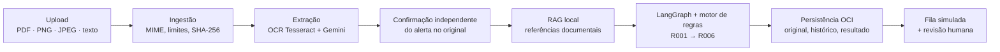

# MediFlow — Entrega final do Hackathon ONE (G10 · Equipe 17)

Este documento reúne os quatro entregáveis da submissão: **documentação**, **vídeo demo**, **ferramentas** e **links**. Os detalhes técnicos completos estão no [README](../README.md) e nos relatórios de homologação em [`docs/`](.).

---

## 1. Documentação — o que fizemos, como e por quê

### O que fizemos

O **MediFlow** é um agente de **triagem e roteamento documental** para documentos de saúde **sintéticos**. Ele recebe um PDF, uma imagem ou um texto, extrai as informações estruturadas, confere inconsistências e encaminha o documento a uma **fila administrativa simulada** (prontuário, farmácia, autorizações ou auditoria humana). Cada decisão vem acompanhada da regra aplicada, das evidências literais do original e do histórico de execução.

> **Não é um sistema clínico.** O MediFlow não diagnostica, não prescreve e não autoriza procedimentos. Todos os documentos usados são fictícios.

### Por quê

Em clínicas e operadoras, a recepção de laudos, receitas e solicitações ainda costuma ser manual: alguém lê cada documento, identifica o tipo e decide para onde ele vai. Esse trabalho é lento e sujeito a erros, e um documento com alerta pode ficar parado na fila errada. Queríamos mostrar que a IA pode **acelerar a leitura** sem **tirar o controle humano** das decisões:

- **A IA extrai, mas não decide.** O encaminhamento sai de um motor de regras determinístico e versionado (R001–R006), que pode ser auditado e reproduzido.
- **Nada é inventado.** Um campo ilegível fica `null` e o documento vai para auditoria humana. O sistema não completa dados por suposição.
- **Alertas são confirmados no original.** Um marcador de alerta só gera prioridade se for encontrado no documento original, por uma leitura independente da resposta da IA.
- **Tudo é rastreável.** Original, manifesto (SHA-256), histórico e resultado ficam gravados no Object Storage.

### Como funciona

| Regra | Situação | Destino |
|---|---|---|
| R001 | Alerta expresso confirmado no original | Fila prioritária de avaliação humana |
| R002 | Campo essencial ilegível, ausente ou conflitante | Auditoria humana |
| R003 | Solicitação de exame completa | Auditoria de autorizações |
| R004 | Receituário completo | Fila documental da farmácia |
| R005 | Documento de rotina completo | Prontuário documental |
| R006 | Nenhuma das anteriores, ou indicador de qualidade abaixo de 0,75 | Auditoria humana |

**Indicador de qualidade:** cada extração recebe uma nota de 0 a 1 (completude, evidências, consistência e identificação do profissional). Quando a nota fica abaixo do limiar, o documento é desviado para revisão humana. É uma heurística explicada no próprio resultado, **não uma confiança clínica**.

**Interface:** um painel em Streamlit permite enviar documentos (arquivo ou texto), ver o resultado com a regra principal e as evidências e trabalhar na fila de auditoria, onde o revisor aprova, corrige ou rejeita sem alterar o resultado original.

### Resultados

| Cenário | Documento | Regra | Destino |
|---|---|---|---|
| Rotina | DOC-001, laudo laboratorial | R005 | `prontuario_documental` |
| Alerta | DOC-002, laudo de imagem | R001 | `fila_prioritaria_avaliacao_humana` |
| Ambiguidade | DOC-005, receita ilegível | R002 | `auditoria_humana` |

- **3/3 cenários** aprovados em três níveis: simulação local (H14), Gemini real (H15) e **Gemini + Oracle Cloud reais juntos** (H16, com 12 objetos auditados).
- **575 testes automatizados** offline aprovados, com CI em Python 3.12 e 3.13.

### Limitações e próximos passos

Funciona somente em localhost, não tem autenticação e aceita apenas as amostras sintéticas oficiais. A revisão humana foi validada offline, mas ainda não gravando na OCI real. Os próximos passos são homologar essa gravação, medir custo e latência, calibrar o indicador de qualidade e implementar autenticação antes de qualquer publicação. A lista completa está no [README](../README.md#próximas-etapas).

---

## 2. Vídeo demo

**YouTube:** `<COLAR O LINK DO VÍDEO AQUI>`

Roteiro sugerido (3–5 min):

1. Problema e proposta (30 s).
2. Arquitetura em um slide: a IA extrai e as regras decidem (30 s).
3. Interface Streamlit: enviar DOC-001 → R005, prontuário (45 s).
4. DOC-002 → R001, fila prioritária, com a evidência do alerta destacada (45 s).
5. DOC-005 → R002, dose ilegível preservada como `null` (45 s).
6. Fila de auditoria: revisão humana de um caso (30 s).
7. Objetos gravados no bucket OCI e testes/CI verdes (30 s).
8. Limitações e próximos passos (15 s).

---

## 3. Ferramentas

| Área | Ferramentas |
|---|---|
| Linguagem e API | Python 3.12/3.13, FastAPI, Uvicorn, Pydantic, JSON Schema |
| Leitura de documentos | PyMuPDF, pypdf, Pillow, Tesseract OCR (`por`) |
| Inteligência artificial | Google Gemini (`google-genai`), LangGraph, RAG local com fichas versionadas |
| Regras | Motor determinístico com regras em YAML (`rules/`) |
| Nuvem | Oracle Cloud Infrastructure — Object Storage (SDK `oci`) |
| Interface | Streamlit, pandas, Altair |
| Qualidade | pytest, httpx, GitHub Actions (CI 3.12/3.13) |
| Colaboração | Git, GitHub (fluxo `develop` → `main`, PRs com revisão), VS Code |
| Diagramas | Mermaid, Graphviz (`diagramas/`) |
| Assistentes de IA no desenvolvimento | `<LISTAR SE A EQUIPE QUISER DECLARAR, ex.: Claude Code>` |

---

## 4. Links

| Item | Link |
|---|---|
| Repositório | https://github.com/No-Country-simulation/G10-BRASIL-EQUIPO17 |
| README técnico | [README.md](../README.md) |
| Vídeo demo | `<COLAR O LINK DO YOUTUBE>` |
| Deploy | Não publicado de propósito: o protótipo roda somente em localhost, sem autenticação e com documentos sintéticos (ver [Segurança e limitações](../README.md#segurança-e-limitações)). Para rodar, siga a [demonstração local](../README.md#executar-a-demonstração-local). |
| Design / protótipo de interface | `<COLAR O LINK (Figma, Canva etc.), se houver>` |
| Diagrama do grafo | [diagramas/grafo_mediflow_v0.1.png](../diagramas/grafo_mediflow_v0.1.png) |
| Evidência H16 (Gemini + OCI reais) | [docs/29_h16_homologacao_http_gemini_oci_real.md](29_h16_homologacao_http_gemini_oci_real.md) |
| Critérios de homologação | [docs/16_criterios_homologacao_mvp.md](16_criterios_homologacao_mvp.md) |
| Pull requests | https://github.com/No-Country-simulation/G10-BRASIL-EQUIPO17/pulls |
