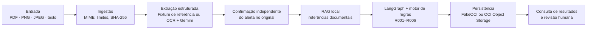

# MediFlow — Entrega do Hackathon ONE (G10 · Equipe 17)

Este documento apresenta a solução, as tecnologias, os resultados das validações e os materiais de demonstração do MediFlow. Os detalhes da arquitetura e as instruções de execução estão no [README técnico](../README.md).

## 1. Documentação — o que fizemos, como e por quê

### O que fizemos

O **MediFlow** é um agente de **triagem e roteamento documental** desenvolvido no contexto do Hackathon ONE. Recebe documentos sintéticos de saúde em PDF, imagem ou texto, classifica o tipo documental, extrai informações estruturadas e determina o encaminhamento para filas administrativas simuladas. O resultado registra a regra aplicada, as evidências disponíveis e o histórico de execução.

> **Protótipo educacional:** o MediFlow não diagnostica, não prescreve, não autoriza procedimentos e não substitui profissionais de saúde. Os documentos utilizados são fictícios.

### Por quê

A leitura e a transcrição manual de laudos, receitas e solicitações podem consumir tempo e dificultar a organização do fluxo documental. A proposta do MediFlow é auxiliar esse trabalho com extração estruturada, regras reproduzíveis e supervisão humana.

- **Extração estruturada:** a IA auxilia na identificação dos dados do documento, validados por um contrato Pydantic.
- **Roteamento determinístico:** regras versionadas (R001–R006) definem o encaminhamento, sem delegar essa decisão exclusivamente à IA.
- **Preservação de informações incertas:** campos ausentes ou ilegíveis não são preenchidos por suposição; ambiguidades críticas exigem revisão humana.
- **Confirmação de alertas:** a prioridade documental depende de um marcador de alerta confirmado no original por leitura independente da resposta da IA.
- **Rastreabilidade:** originais, manifestos com SHA-256, históricos, resultados, índices de status e revisões possuem registros relacionados. A persistência utiliza armazenamento em memória na demonstração e Oracle Cloud Infrastructure (OCI) Object Storage nas validações com armazenamento real.

### Como funciona

| Modo | Extração | Armazenamento |
|---|---|---|
| Demonstração local | Resultados de extração de referência (fixtures) | Temporário em memória (FakeOCI) |
| Validação da extração real | Gemini, com OCR quando aplicável | FakeOCI |
| Validação multimodal híbrida optativa | Gemini com original PDF/imagem e referência textual independente | FakeOCI |
| Validação integrada com serviços reais | Gemini, com OCR quando aplicável | OCI Object Storage |
| Validação específica de persistência e revisão humana | Fixtures textuais | OCI Object Storage |

A API, a recuperação de referências (RAG), as regras e o grafo de decisão são componentes executáveis também no modo demonstrativo. O modo local não exige chamadas ao Gemini nem gravações na OCI real.

| Regra | Situação | Destino |
|---|---|---|
| R001 | Marcador de alerta confirmado no original | Fila prioritária de avaliação humana |
| R002 | Campo essencial ilegível, ausente ou conflitante | Auditoria humana |
| R003 | Solicitação de exame completa | Auditoria de autorizações |
| R004 | Receituário completo | Fila documental da farmácia |
| R005 | Documento de rotina completo | Prontuário documental |
| R006 | Sem condições de roteamento automático, incluindo qualidade insuficiente quando aplicável | Auditoria humana |

**Indicador de qualidade:** heurística de 0 a 1 baseada em completude, evidências, consistência e identificação do profissional. O limiar padrão de 0,75 impede o roteamento automático de rotina quando a qualidade é insuficiente, preservando a precedência dos alertas confirmados e das ambiguidades críticas. O indicador não representa probabilidade de acerto clínico.

**Interface:** a aplicação Streamlit oferece visão geral dos documentos, envio de arquivo ou texto, resultado com regra e evidências, e fila de auditoria. Aprovação, correção e rejeição são decisões humanas distintas. As alterações declaradas pelo revisor são registradas separadamente, inclusive durante a rejeição, sem substituir a extração original. O nome do revisor é declarativo.

**Armazenamento:** o bucket de desenvolvimento da OCI contém prefixos distintos para originais, metadados, históricos, resultados, índices de documentos processados, índices de auditoria humana e revisões. A segregação é lógica por prefixos, e a integridade é verificada por leitura posterior e SHA-256 nas operações homologadas.

### Resultados

| Cenário | Documento | Regra | Destino |
|---|---|---|---|
| Rotina | DOC-001, laudo laboratorial | R005 | `prontuario_documental` |
| Possível urgência documental | DOC-002, laudo de imagem | R001 | `fila_prioritaria_avaliacao_humana` |
| Ambiguidade | DOC-005, receita ilegível | R002 | `auditoria_humana` |

- **Demonstração local:** três cenários aprovados com extração de referência e FakeOCI.
- **Extração real:** três cenários aprovados com Gemini real e FakeOCI.
- **Integração real:** três cenários aprovados com Gemini e OCI Object Storage no mesmo fluxo HTTP, com 12 objetos auditados. [Relatório de integração real](29_h16_homologacao_http_gemini_oci_real.md).
- **Persistência e revisão humana na OCI:** dois cenários textuais, três execuções, três índices de status e uma revisão humana gravada e recuperada. O reprocessamento não herdou a revisão anterior. Foram auditados 43 objetos, incluindo 14 novos e 29 históricos preservados por SHA-256. Essa validação utilizou extração de referência, sem chamadas Gemini reais. [Relatório de persistência e revisão humana](31_h17_homologacao_persistencia_oci_real.md).
- **Extração multimodal híbrida:** três cenários aprovados com os bytes originais (dois PDFs e um PNG) enviados ao Gemini real junto com a referência textual, com FakeOCI. Ativação optativa; validação de evidências e regras preservadas. [Relatório e limitações](32_homologacao_multimodal_gemini.md).
- **Qualidade automatizada:** 624 testes offline aprovados e 3 deselecionados, compilação sem erros (21/11/2026); CI Python 3.12/3.13 pós-merge do [PR #71](https://github.com/No-Country-simulation/G10-BRASIL-EQUIPO17/pull/71) aprovada ([execução](https://github.com/No-Country-simulation/G10-BRASIL-EQUIPO17/actions/runs/44974502834)).

### Estado da implantação OCI

Em 21/11/2026, a equipe de infraestrutura reportou novo processamento do DOC-001 e inventário de 47 objetos no bucket; esse total ainda não constitui nova auditoria independente. A evidência anterior de 43 objetos auditados permanece o registro comprovado. A rede de desenvolvimento foi preparada em São Paulo (`sa-saopaulo-1`), com SSH restrito e portas da aplicação sem exposição externa. O provisionamento da VM `VM.Standard.A1.Flex` (2 OCPUs, 12 GB) foi bloqueado por falta de capacidade em AD-1. A VM ainda não foi criada, a aplicação não foi validada nela e o objetivo Always Free não equivale a uma comprovação de custo zero. A reprodução local e as validações anteriores do Object Storage não dependem dessa VM.

### Escopo de utilização

A demonstração é executada em ambiente local controlado e aceita somente as amostras sintéticas oficiais. O armazenamento em memória é temporário. As validações com serviços reais foram realizadas separadamente, com configurações controladas. O protótipo não possui autenticação de usuários e revisores; seus resultados não constituem diagnóstico ou decisão clínica. A generalização para documentos arbitrários e a validação clínica não integram o escopo comprovado. A extração híbrida fornece ao Gemini o arquivo original e a referência textual independente, que continua obrigatória para validar evidências. Isso não elimina a restrição às amostras sintéticas oficiais nem garante extração válida para todo layout.

Para reproduzir a aplicação, consulte o [README técnico](../README.md) e o [guia da interface](../src/mediflow/ui/README.md).

## 2. Vídeo demo

**YouTube:** `<COLAR O LINK DO VÍDEO AQUI>`

## 3. Ferramentas

| Área | Ferramentas |
|---|---|
| Linguagem e API | Python 3.12/3.13, FastAPI, Uvicorn, Pydantic, JSON Schema |
| Leitura de documentos | PyMuPDF, pypdf, Pillow, Tesseract OCR (`por`) |
| Inteligência artificial | Google Gemini (`google-genai`), LangGraph, RAG local com referências versionadas |
| Regras | Motor determinístico com regras em YAML (`rules/`) |
| Nuvem e armazenamento | Oracle Cloud Infrastructure — Object Storage (SDK `oci`); FakeOCI na demonstração local |
| Interface | Streamlit, pandas, Altair |
| Qualidade | pytest, httpx, GitHub Actions (CI 3.12/3.13) |
| Colaboração | Git, GitHub, VS Code |
| Diagramas | Mermaid, Graphviz (`diagramas/`) |

## 4. Links

| Item | Link |
|---|---|
| Repositório | https://github.com/No-Country-simulation/G10-BRASIL-EQUIPO17 |
| README técnico | [README.md](../README.md) |
| Vídeo demo | `<COLAR O LINK DO YOUTUBE>` |
| Guia da interface | [Streamlit — instalação e execução](../src/mediflow/ui/README.md) |
| Diagrama do grafo | [Grafo de decisão](../diagramas/grafo_mediflow_v0.1.png) |
| Validação da extração com Gemini real | [Relatório de validação da extração](27_h15_homologacao_http_gemini_real.md) |
| Validação integrada com Gemini e OCI reais | [Relatório de integração real](29_h16_homologacao_http_gemini_oci_real.md) |
| Validação da persistência e revisão humana na OCI real | [Relatório de persistência e revisão humana](31_h17_homologacao_persistencia_oci_real.md) |
| Validação multimodal com Gemini real e FakeOCI | [Relatório](32_homologacao_multimodal_gemini.md) |
| Critérios técnicos de homologação | [Matriz de critérios e evidências](16_criterios_homologacao_mvp.md) |
